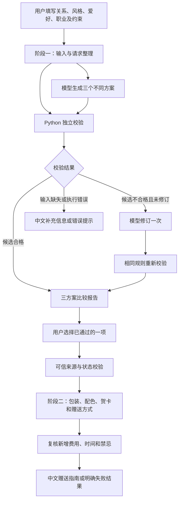
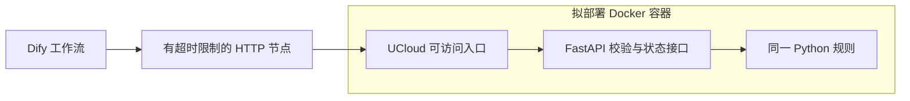

# 技术架构：设计方案，尚未部署

更新日期：2026-10-29（亚洲／上海）。产品定位以[产品定位统一说明](product-positioning.md)为准，字段以[工作流规范](../workflow/workflow-spec.md)为准。

## 已核实的基线

本地 `Giftwise.ifpkg` 包含“用户输入 → LLM → 输出”三个节点、一个关系输入和连接测试提示词。DSL 格式版本 `0.7.0` 不等于线上 Dify 产品版本。模型实际调用、已发布体验地址、UCloud 资源和容器运行均未核实。现已完成推荐阶段离线 Python 校验器及阶段 B 验收，运行证据见 README；没有已验证的 Dify 规则集成、独立 API 或网站。

## 推荐的最小架构

中文 Web 前端负责表单、三方案比较、明确选择和赠送指南；薄服务端接入层保管 Dify 凭证、可信任务状态及调用接口，不把密钥交给浏览器。Dify 负责模型和编排，独立 Python 代码执行确定性规则。优先将兼容标准库的规则放入 Code 节点，确需独立 API 时复用同一套规则。先不引入数据库、账号或 Kubernetes。

体验分两阶段：先输出三个有理由、有校验结果的选项；用户明确选择已通过校验的一项后，按需生成详细包装、配色、贺卡和赠送方式。基础赠送指南属于 MVP，精美视觉呈现后置。

这是目标设计，不代表系统已运行。所有用户可见导航、按钮、提示、状态和生成内容默认简体中文；技术字段和错误代码可保持稳定标识。

## 两阶段状态与信任边界

第一阶段保留原始请求、初始候选、两次校验、修订候选和修订次数。模型不得覆盖用户事实与硬约束。第二阶段采用单独按需工作流或等效调用步骤；未选择时不生成全部三项的详细包装，不能自动替用户决定。

选择输入必须可追溯至请求、候选版本、方案 ID 和修订次数。不能信任浏览器传来的 `passed: true`。采用服务端保存或签名的可信快照，核对来源、版本、候选和跨阶段修订次数，并在必要时重新校验约束。单纯重检客户端数据不能证明候选来源或修订次数。没有可信快照时仅允许标明人工衔接的受控演示，不宣称网页闭环完成；前端状态不能充当校验工具。

包装可能增加总费用和准备时间，输出前须检查礼物加材料等全部费用、时间与禁忌。预算余量不足时可提供不增加费用的基础方案，不能沿用裸礼物通过结果。

同一送礼任务跨两个阶段最多一次自动模型修订。第一阶段用掉额度后，第二阶段失败应如实返回待调整项，不得重置次数。第二阶段首次生成属于基础调用而非修订，但仍应计入模型用量。校验失败不可绕过。

## Code 节点与服务决策

Dify 的 [Code 文档](https://docs.dify.ai/en/cloud/use-dify/nodes/code)说明其支持声明输入输出并执行 Python 或 JavaScript；[If-Else 文档](https://docs.dify.ai/en/cloud/use-dify/nodes/ifelse)提供结果分支依据。确定性检查适合先尝试 Code，但须在真实环境验证沙箱、标准库和输出限制。本地通过不代表 Dify 可运行。网络访问交给 HTTP 节点或服务。

| 技术 | 用途与成本 | 决策与替代方案 |
| --- | --- | --- |
| Dify + Code | 降低搭建工作，仍有平台和模型费用 | 首选核心闭环，先测实际沙箱 |
| Python | 离线确定性规则，不消耗模型用量 | 第一编码任务，同一实现供节点或服务复用 |
| FastAPI | 独立校验与可信状态接口，增加维护工作 | 比赛要求、沙箱不兼容或明确工程里程碑需要时引入 |
| Docker | 可复现打包，增加构建托管工作 | 选择 API 路径或赛题强制要求时采用 |
| UCloud | 托管可选 API，涉及资源与网络费用 | 先核实资源、区域、权限和预算 |
| GitHub | 公开规范、源码与历史 | 只放经审查的资料及虚构测试数据 |

当前未核实费率或云额度，真实运行前取得当期价格并确定花费上限，缺失数据记“未知”。

## 条件性云端扩展

扩展尚未实现。托管 Dify 不能访问开发电脑的 `localhost`；地址、认证、网络和 TLS 须单独配置实测。凭证不能出现在提示词、截图或公开导出。超时提示“校验暂不可用”，不得放行未检查内容。

向主办方确认是否强制容器或 Kubernetes、是否允许 Dify Cloud 与外部模型、提供的 UCloud 额度、部署证据及准确截止时间。当前未取得完整可核实规则。只用 Code 不能宣称已有独立容器化服务；确认的强制要求优先于视觉精修。

运行记录包括阶段、请求和候选版本、节点状态、全局修订次数、错误、耗时、调用数、用量与成本依据。两阶段分别计时计费。无真实商品数据时，不能承诺实价、库存和送达；关系适配是风险建议。演示故障时使用明确标注的真实录屏，不能伪造现场结果。
