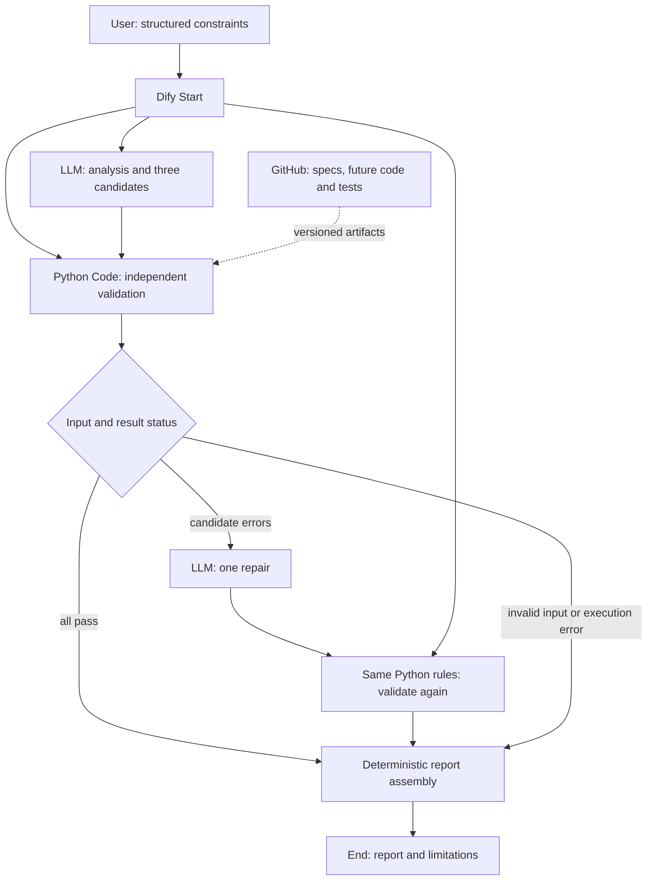
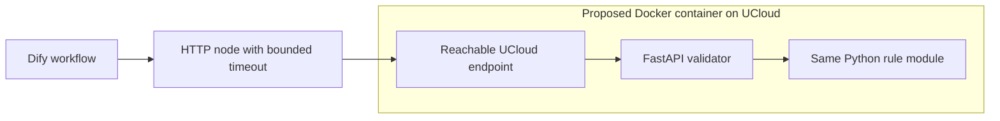

# Architecture — proposed, not deployed

## Observed baseline

On 2026-10-29, inspection of the preserved local `Giftwise.ifpkg` found a Dify app export with Start → LLM → End, one relation input, and a connection-test prompt. The export uses DSL schema `0.7.0`; this is not a verified Dify product version. Live model calls, provider credentials, published app access, UCloud resources, and containers have not been verified. No validator or API exists in this baseline.

## Recommended first path

Use Dify for orchestration and model calls; use a deterministic, standard-library Python validator callable from a Dify Code node. Keep the constraints from Start separate from model-generated candidate data. Store state in run variables: original request, initial candidates, validation results, repair count, revised candidates, final results. No persistent database is needed.

This diagram describes the target workflow, not a running system. Branches may use separate report / End nodes initially to avoid unsafe references to skipped nodes. Business failure has a structured result; infrastructure failure must never route to success.

## Code node feasibility and service decision

Dify documents Python / JavaScript execution with declared input and output variables in its [Code node](https://docs.dify.ai/en/cloud/use-dify/nodes/code). Deterministic local checks are therefore a reasonable initial fit. This is an architectural inference; compatibility with the owner's actual environment still needs a sandbox smoke test. Network calls belong in an HTTP node rather than validator code. The [If-Else node](https://docs.dify.ai/en/cloud/use-dify/nodes/ifelse) supplies conditional routing.

Run a small sandbox smoke test using the proposed validator dependencies, including decimal handling. Prefer JSON-string payloads plus shallow status outputs at Dify node boundaries; configure actual output types in the UI. Do not presume local Python compatibility proves Dify compatibility. If a required library is unavailable, adapt using safe standard-library logic or use the optional API after assessing time and rules.

| Choice | Purpose / cost | Decision and fallback |
| --- | --- | --- |
| Dify + Code | Lowest setup effort; provider / platform usage costs still apply | First choice for the core loop; verify sandbox and output limits |
| Pure Python module | Test deterministic rules offline without model costs | First coding task; reusable implementation rather than two divergent validators |
| FastAPI | Stable HTTP contract and independent service boundary; more setup | Add only for required deployment, sandbox incompatibility, or an explicit engineering milestone |
| Docker | Reproducible optional API packaging; image build / hosting effort | Package the API if selected; a diagram is not containerization evidence |
| UCloud | Host the optional API; resource charges / networking setup | Check account resources, region, access, budget, and rules before provisioning |
| GitHub | Public review and version history | Use reviewed fictional data and sanitized artifacts |

No current prices or credits have been verified. Before live runs, set a user-approved spending cap and obtain current provider / cloud rates from the relevant console; record actual usage without inventing estimates.

## Conditional cloud extension

This extension is unimplemented. Hosted Dify cannot reach a developer's `localhost`; the real endpoint, authentication, network access, and TLS must be configured and tested privately. Keep credentials in managed settings, never prompts, screenshots, or public exports. On timeout, report validation unavailable; never accept unchecked candidates. A single bounded infrastructure retry may be evaluated later; the MVP has no automatic model retries and at most one business repair.

## Competition and operational gates

Confirm with organizers: compulsory containerization or Kubernetes; whether Dify Cloud / external models are allowed; supplied UCloud compute or credits; required deployment evidence; exact submission deadline. No poster or official rulebook has been supplied here. A Code-only demo may demonstrate independent checks but cannot claim an independent containerized cloud service. Promote mandatory architecture work before polishing presentation.

Collect run ID, revision, node status, repair count, redacted rule errors, duration, token usage, and cost basis. Do not log real recipient details or keys. A provider outage should produce an honest error report and use an explicitly labeled prerecorded backup during a demo, never fabricated live output.
