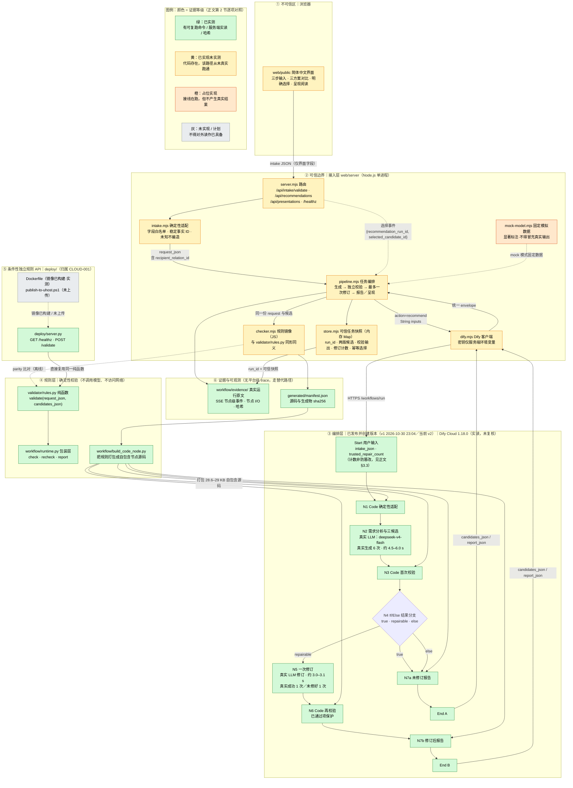
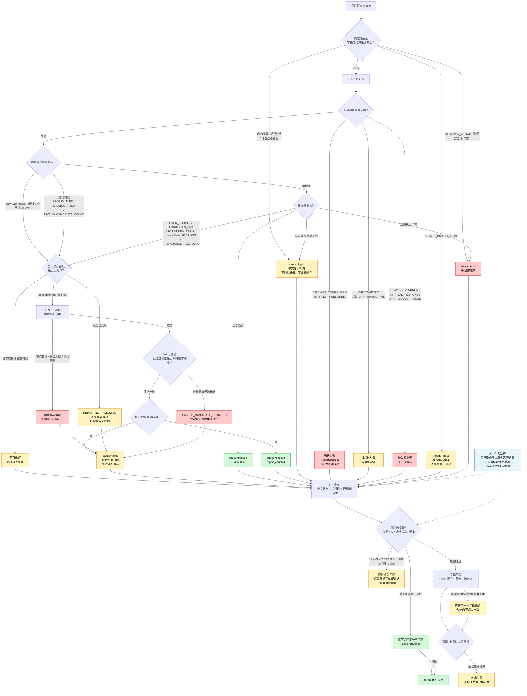

# 技术架构：为什么采用该架构（赛道 B 系统架构设计文档）

- 任务：ARCH-001（阶段 3 技术方案设计）；负责人：GiftWise｜架构 Agent
- 更新日期：2026-10-30（亚洲／上海，UTC+8）
- 交付截止：2026-11-01 10:30（北京时间）
- 产品定位以 [Issue #1](https://github.com/sunnyyang0822-stack/GiftWise-AI/issues/1) 正文为唯一权威；字段以[工作流规范](../workflow/workflow-spec.md)与[三步输入契约](intake-contract.md)为准；需求基线与成功标准 SC-1…SC-9 见[需求分析](requirements-analysis.md)。
- **本文只描述真实状态。所有能力都标注证据等级，未实测的一律写明「未实测」。**

> **口径时点声明（2026-10-31 由数字口径统一扫描线追加）**：本文正文的**已实测表格**与 **§10 的逐字命令 / HTTP 输出**是 **2026-10-30 21:17–22:5x** 的转录（该时点真值，按纪律**保留原文不改写**）。其后的现行真值一律以 `docs/acceptance-criteria.md` 第 1 节与第 13 节为权威：单元测试 **329**（原 322）、独立验收套件**四条互不包含、合计 688**（329＋275＋39＋45）、容器检查项 **14 项**（原 9/9）、JS↔Python parity **74 组**（原 55 组；越界与格式 17 组已覆盖；另 1 组仅错误顺序不同，`days=10**20` 在网格之外、两侧都拒绝）、冷构建**两个合法值**（2026-10-30 基线 **1.720 s**、2026-10-31 重建版 **3,662 ms**；原记 2.2 s 无归档）、镜像体积（构建时基线 **177,582,258 字节＝169.36 MiB**、交付镜像 **177,918,474 字节＝169.676 MiB**）、规则哈希 **`1f389dad…`**（旧值 `4782255b…` 已作废）、模型调用**双口径**（主批次 10 次 / 34,127；**累计 13 次 / 38,326**）、Dify **已发布并创建版本（v1/v2）**、交付镜像**已于 2026-10-31 01:13:59 重建并复核**（`submission-20261101` = `latest` = `d9a4a35763ee`）。**§10 中的旧数字因此是历史转录，不是当前结论。**

## 0. 本文件回答什么问题（对齐评分规则赛道 B）

评分规则 1.2 要求：**"系统架构设计文档是赛道 B 的重点交付物：不能只画技术组件图，还应解释为什么采用该架构，以及它如何支撑当前应用的负载、状态管理、扩缩容和故障恢复。"** 本文件逐项对应：

| 评分规则条目（赛道 B） | 本文位置 | 图件／附件 |
| --- | --- | --- |
| 系统架构设计文档：架构图、核心组件、服务拆分、技术选型及设计理由 | §2 架构图、§4 组件职责与依赖方向、§5 选型取舍 | [主架构图源](architecture/diagrams/system-architecture.mmd) · [渲染 SVG](architecture/rendered/system-architecture.svg) |
| **为什么采用该架构**：负载、状态管理、扩缩容、故障恢复 | §3.1–§3.5 | 同上 |
| Agent 执行流程：任务规划、工具调用、上下文和状态管理、多步骤执行 | §2.3 数据流、§3.3 状态管理、[ADR-002](architecture/adr/ADR-002-two-phase-and-trusted-state.md) | 主架构图 |
| **异常处理说明**：工具调用失败、模型输出异常、超时、重试、状态恢复、人工介入 | **§6（独立成节，逐项六条）** | [异常与恢复图源](architecture/diagrams/failure-recovery.mmd) · [渲染 SVG](architecture/rendered/failure-recovery.svg) |
| 可观测性证据：关键日志、运行状态、调用记录或指标 | §7 摘要 | [可观测性设计](architecture/observability.md) · [可观测性数据流图](architecture/diagrams/observability-flow.mmd) |
| 成本与性能分析：API 成本、端到端延迟、资源消耗、瓶颈、优化方向 | §8 摘要 | [成本与性能指标清单](architecture/cost-performance-metrics.md) |
| 云原生架构与技术选型：Docker/K8S、微服务、弹性伸缩、资源调度、分布式状态 | §5（逐项标注实测/计划） | [ADR-003](architecture/adr/ADR-003-cloud-native-tradeoffs.md) |
| 架构图（赛道 B 必交） | §2 + `architecture/diagrams/` + `architecture/rendered/` | 3 张图，均已真实渲染验证 |

### 0.1 证据等级（全文统一标号，不得混用）

| 等级 | 含义 | 判定标准 |
| --- | --- | --- |
| **E1 已实测** | 已真实运行并取得可复跑证据 | 有命令与输出、或服务端实读回执、或文件哈希；本文引用均带出处 |
| **E2 已实现未实测** | 代码存在且可读，但该路径从未真实跑通 | 不得读作"已可用" |
| **P 占位实现** | 接线在运行，但不产生真实结果 | 必须显式说明占位，不得读作"已生成" |
| **E3 计划／未实现** | 只有设计，无实现 | 不得出现在"已完成"清单 |
| **U 未知** | 无任何数据 | 记 `unknown`／`not_measured`，**不填默认值、不填 0** |

## 1. 一页事实基线（已实测 / 未实现，分开写）

### 1.1 已实测（E1，可在本机复跑或已有服务端实读证据）

| 事实 | 证据出处 |
| --- | --- |
| 本地规则探针 **46 项通过、0 失败**，`model calls: 0`、`cloud verified: false` | 本次复跑：`python workflow/verify_local.py`（见 §10） |
| 单元测试 **329 项通过**（原记 322，为 2026-10-30 时点值） | 本次复跑：`python -m unittest discover -s tests -q` → `Ran 329 tests / OK`（2026-10-31） |
| 阶段 C 独立验收套件 **39 项通过** | 本次复跑：`python -m unittest discover -s tests/acceptance/stage_c -q` → `Ran 39 tests / OK` |
| 独立验收套件**四条互不包含**、合计 **688 项**（329 ＋ 275 ＋ 39 ＋ 45） | 本次复跑四条全绿（2026-10-31）；`discover -s tests` **只覆盖第一条**（`tests/acceptance/**` 无 `__init__.py`），故「329 项通过」**≠**「全仓通过」；口径出处 `docs/test-plan.md:214` 起 |
| 规则源码与 5 个生成物哈希一致、非 STALE | `workflow/generated/manifest.json`；本次复跑输出的 `sources_sha256`／`artifacts_sha256` |
| **N1–N7 + 双 End 已在真实 Dify Cloud 1.18.0 草稿接线**：11 节点／11 边、含 `if-else` 三分支 | WF-003（`workflow/evidence/WF-003-2026-10-30.md` §3.2，服务端实读回执 `dify-draft-server-readback.txt`） |
| **五类用例在真实 Dify 上跑通（第一轮·注入路径）**（正常三候选／超预算／禁忌／损坏 JSON／持续失败），分支路径与预期一致，该轮 `total_tokens` 全为 **0** | WF-003 §3.4；节点级原文 `workflow/evidence/WF-003-2026-10-30/dify-node-io-*.md` |
| **真实模型链路已跑通（第二轮，2026-10-30 21:11–21:17）**：N2／N5 为真实 `type: llm` 节点（provider `langgenius/deepseek/deepseek`、model `deepseek-v4-flash`），3 批 **6 次真实运行、主批次 10 次调用 / 34,127 tokens**（**累计 13 次 / 38,326 tokens**）；含真实生成、**真实自然违规**（模型写出「不含酒精」被 `FORBIDDEN_TERM` 拒绝）、**真实修订成功 1 次**、**真实持续失败 1 次**；`selected_candidate_id` 全程 `null` | WF-003 §4.5–§4.7；`workflow/evidence/WF-003-2026-10-30/dify-real-node-io-*.md` |
| 单个 Code 节点 **28,682–28,951 字符**可在 Dify Cloud 保存并执行；工作流服务端耗时 **0.587–0.888 s**（**无模型**） | WF-003 §3.4 |
| Dify Code 节点沙箱可用：`json`／`re`(含 `re.ASCII`)／`unicodedata`(NFKC)／`decimal` 四项能力均为 true | WF-002（`workflow/evidence/WF-002-2026-10-30.md`）；QA 独立复跑复核（`docs/test-reports/stage-c/acceptance-2026-10-30.md` §1） |
| Dify 租户 **无平台级追踪**：`trace-runs` 返回 `not_collected` | WF-002；QA 复核 §1.3 |
| `deploy/server.py` 可运行：`/healthz` 200、`/validate` 200 且响应与 `validator.rules.validate` **逐字段一致**、400 `INVALID_PAYLOAD`、404 `NOT_FOUND`、413 `REQUEST_TOO_LARGE` | 本次实测（见 §10.3，含我自己发现的启动方式问题） |
| JS 接入层与 Python 参考实现**语义一致**：**74 组**样例 0 处差异（越界与格式 17 组已覆盖；另 1 组仅**错误顺序**不同；**网格之外** 1 项 `days=10**20` 分类口径，两侧都拒绝） | 本次复跑：`node web/tools/parity-check.mjs` |
| 本地单次确定性校验 p50 **0.166 ms**；无模型端到端固定夹具 p50 **0.640 ms** | 本次实测：`.tmp/measure_arch.py`（方法与其缺陷见 §8.2） |
| 契约已冻结 **8 个关系 ID**（含 `pursuit`），`pursuit` 与 `partner` 并列互斥 | `docs/intake-contract.md`；`workflow/labels.py`；QA §3.2 |
| **容器化已实测（2026-10-30 晚；2026-10-31 01:13:59 重建并复核）**：镜像 `giftwise-validator:latest` 构建成功（`docker images` **178 MB** 十进制；`docker inspect` Size **177,582,258 字节＝169.36 MiB**）；容器内 `/healthz` 200 且规则哈希与本机一致、`/validate` 与本机纯函数**逐字节一致**、5 项错误路径符合契约、以**非 root（uid 10001）**运行、镜像内无密钥、文件树 9 行 | `deploy/evidence/docker-2026-10-30.md`（D-0…D-13 共 **14 项**；原记 9/9）；`deploy/evidence/image-audit-2026-10-31.md`、`deploy/evidence/image-rebuild-n1n4-2026-10-31.md`（**已重建并复核**：`submission-20261101` = `latest` = `d9a4a35763ee`，体积 **177,918,474 字节＝169.676 MiB**，冷构建 **3,662 ms**，规则哈希 `1f389dad…` 与本机一致）；`deploy/evidence/raw/docker-2026-10-30/`（12 份原始输出 + 5 份安装日志）；**本架构 Agent 已独立复跑复核（§10.6）** |

### 1.2 未实现／未实测（不得读作已完成）

| 项 | 真实状态 |
| --- | --- |
| **真实模型生成与修订** | **已发生（2026-10-30 21:11–21:17）**：N2／N5 已替换为真实 `type: llm` 节点（`deepseek-v4-flash`），**10 次调用 / 34,127 tokens**（服务端 `total_tokens` 累加；**累计 13 次 / 38,326 tokens**）。**早期 20:58 那一轮仍是占位节点（0 tokens）**，两轮必须分开读。**仍未取得**：修正提示词后的真实修订运行时证据（第 3 批两条首次即通过）、自然 `OVER_BUDGET`、标签级 `FORBIDDEN_TAG` 触发、模型稳定性样本（仅 6 次） |
| Dify 草稿发布 | **已发布并创建版本**（v1 于 2026-10-30 23:04 +08:00；v2 已重发布）。⚠️ `tool_published: false` 与 `version: "draft"` **不是发布状态判据**——前者只表示「是否作为工具供其他应用调用」，后者描述**当前草稿行**；原记「未发布／未创建版本」**已不成立**（WF-003 §3.2 为该时点观测） |
| DeepSeek 在该租户的可用性 | **已配置并真实调用成功**（`custom_configuration.status = active`、4 个模型 `active`；WF-003 任务 C）。早期观测（`enabled = false`、凭据为空）**已被取代**。平台托管 `openai`／`gemini`／`tongyi`／`anthropic`／`x` **仍未使用** |
| 选择后呈现阶段（包装／配色／贺卡／赠送方式） | 产品侧**未实现**；接入层仅有 mock 呈现（E2） |
| 跨调用可信修订计数持久化 | **未实现**；当前 `trusted_repair_count` 由 Start 输入提供，**不是防篡改机制**（WF-003 §6.5） |
| 可信快照持久化 | **未实现**；接入层为**进程内存**（重启即丢失），见 §3.3 |
| 云部署 | **从未发生**；`publish-to-uhost.ps1` **从未上传**；无云主机、无 EIP、无镜像仓库推送、无编排平台 |
| 前端页面验收 | **未验收**；QA 的 14 项为 mock 模式有界冒烟，**不构成 WEB-001 验收判定** |
| 成本（金额）与浏览器端到端延迟 | **仍未测量**：token 与调用次数**已有服务端依据**（主批次 10 次 / 34,127 tokens；累计 13 次 / 38,326 tokens），但**供应商单价未取得真实账单**，金额记 `not_measured`（不得按公开牌价推算）；「用户点击→三方案可用」的浏览器端到端延迟未测（接入层未接真实模型） |
| 真实商品价格／库存／物流 | **完全没有**；价格与准备时间仅为估算 |

> **2026-10-30 晚两次更新**：①**容器化**——本表原有「Docker 构建｜从未构建」一行**已被真实构建取代，该行移入 §1.1**（镜像 `giftwise-validator:latest` 178 MB；容器内 `/healthz` 200、`/validate` 与本机纯函数逐字节一致）。②**真实模型**——原「真实模型生成与修订｜未发生」一行**已被真实 DeepSeek 节点取代**（N2／N5 为 `type: llm`，主批次 10 次调用 / 34,127 tokens；累计 13 次 / 38,326 tokens）。本表保留的否定项**只针对云部署、编排与呈现阶段**：仍无云主机、无 EIP、无镜像仓库推送、无多副本、无弹性伸缩、无资源调度、无分布式状态、无选择后呈现。

> **与任务书的一处事实校正（已与 PM 确认）**：任务书写"N1–N7 未接线"。该结论在 QA-001 观测时刻（2026-10-30 20:53）成立，但已被 WF-003（20:58 起）的真实接线与五类用例运行**取代**。本文采用后者：**接线已实测**；模型部分再由 WF-003 任务 C 更新为**已接真实 DeepSeek（主批次 10 次调用 / 34,127 tokens；累计 13 次 / 38,326 tokens）**。"接线"与"模型调用"是两件事，且**早期占位轮（0 tokens）与真实模型轮必须分开陈述**。

## 2. 架构图与组件、边界、数据流

### 2.1 主架构图

> 图源（单一事实源）：[`docs/architecture/diagrams/system-architecture.mmd`](architecture/diagrams/system-architecture.mmd)
> 渲染产物：[`docs/architecture/rendered/system-architecture.svg`](architecture/rendered/system-architecture.svg)
> 渲染验证：本机 Chrome + mermaid 11 真实渲染，**PASS**（§10.4）。修改图请改 `.mmd` 后重新渲染，并同步本节内嵌块。



**颜色即证据等级**（与 §0.1 一致）：绿＝E1 已实测；黄＝E2 已实现未实测；橙＝P 占位；灰＝E3 未实现。

### 2.2 组件与边界

| 组件 | 职责（一句话） | 依赖方向 | 等级 |
| --- | --- | --- | --- |
| 浏览器界面 `web/public/` | 三步输入、三方案对比、明确选择、呈现阅读；**不持有任何密钥与可信状态** | → 接入层 HTTP | E2（mock 下有界冒烟通过，未验收） |
| 接入层 `web/server/server.mjs` | HTTP 路由与中文状态；可信边界起点 | → 适配／编排／快照 | E2 |
| `intake.mjs` | 确定性适配：字段白名单、稳定事实 ID、未知不编造、不静默补值 | → 规则层（同语义） | E2 |
| `pipeline.mjs` | 任务编排：生成 → 独立校验 → 最多一次修订 → 报告／呈现 | → Dify 客户端／规则镜像／快照 | E2 |
| `store.mjs` | 可信任务快照：运行 ID、两版候选、校验输出、修订计数、幂等选择 | ← 编排写入 | E2 |
| `checker.mjs` | `validator/rules.py` 的 JS 镜像，供 Node 接入层直接调用 | 镜像 → Python 参考实现 | E2（parity 已实测一致） |
| `dify.mjs` | 服务端调用 Dify `/workflows/run`；密钥仅服务端 | → Dify Cloud | E2（**从未成功调用过一次**） |
| Dify 编排 N1–N7 | 多步骤 Agent 链路：适配 → 生成 → 校验 → 分支 → 修订 → 重检 → 报告 | 调用 Code 节点 | E1（接线与五类用例；**N2／N5 已为真实 `type=llm`／`deepseek-v4-flash` 并完成真实调用**） |
| `validator/rules.py` | 确定性规则纯函数：预算、币种、禁忌、必填、准备时间；**不调用模型、不访问网络** | 被依赖，不依赖他人 | E1 |
| `workflow/runtime.py` | 包装层：`check`／`recheck`／`report`、已通过项保护、修订额度不回滚 | → 规则纯函数 | E1 |
| `workflow/build_code_node.py` | 把规则打包成自包含节点源码（Dify Code 无法 import 仓库模块，见 §4.2） | ← 规则源码 | E1 |
| `deploy/server.py` | 条件性独立规则 API，直接复用同一纯函数 | → 规则纯函数 | E1（可运行；**已容器化**，未部署到云端） |
| `workflow/evidence/` | 真实运行原文、节点级 I/O、哈希 | ← 各执行点 | E1 |

**边界（不可信 → 可信的唯一入口）**：浏览器提交的一切都是数据，不是结论。`passed`、`estimated_total`、`repair_count`、`recipient_relation_id` 若由前端提交会被拒绝（`INTAKE_UNKNOWN_FIELD`）。可信状态只由服务端产出与保存。

### 2.3 数据流（一次送礼任务）

1. 浏览器提交界面字段（关系 ID、场合、预算、币种、天数、兴趣、风格、禁忌、备注）。
2. 接入层 `intake.mjs` **重新执行**确定性适配 → 不可变 `request_json`（含服务端产出的 `recipient_relation` 中文文本与 `recipient_relation_id` 机器值）。
3. 编排层把 `request_json`（String）交给生成端。
   - **mock 模式**：`mock-model.mjs` 固定数据，并附显著模拟声明。
   - **dify 模式**（E2，未跑通）：`dify.mjs` → Dify `/workflows/run` → N1→N2→N3→N4 分支。
4. 候选回到接入层，用**同一语义**的规则实现独立校验；未通过且额度未用 → 一次修订 → 再校验（N6 保护已通过项逐字不变）。
5. 报告返回浏览器：`status`、`selectable_candidate_ids`、`repair_count`、`selected_candidate_id: null`、`business_data_verification: not_verified`。
6. 用户**明确选择**后提交 `{recommendation_run_id, selected_candidate_id}`；服务端核对来源、ID、通过状态与版本，命中才进入呈现阶段。
7. 呈现阶段复核新增费用、准备时间与禁忌；失败如实报告，不自动替用户换方案。

## 3. 为什么采用该架构（评分规则 1.2 核心）

### 3.1 约束驱动的选型逻辑

本项目的设计约束不是"技术栈偏好"，而是六条硬约束：

1. **模型输出不可信**：三个候选必须经**独立于模型**的代码校验（SC-3），模型不得覆盖用户预算、天数与明确禁忌。
2. **全局最多一次自动业务修订**（SC-7），且次数不可被前端篡改。
3. **选择前不得生成呈现内容**（SC-5）；必须由用户自己选（不得替选）。
4. **失败不得伪装完成**（SC-9）：没有真实运行就写"未运行"。
5. **交付窗口极短**（约 35 小时）且团队是多个 Agent 并行，**文件边界必须清晰**、不能互相覆盖。
6. **无真实商品数据源**（OPEN-6）：价格与时间只能估算，不得承诺实价、库存、送达。

由此得出的架构是：**"薄接入层 + 确定性规则单点 + 可替换的模型编排 + 证据优先"**。它不是为了高并发设计的，而是为了**可验证性**设计的——每一次"通过"都必须能追溯到具体代码、具体输入与具体版本哈希。这正是评审可核查的点。

### 3.2 负载（当前真实负载特征与依据）

| 维度 | 真实情况 | 依据 |
| --- | --- | --- |
| 请求类型 | 低频、单用户、会话式；**一次送礼任务 = 1–2 次模型调用**（正常 1 次生成，触发修订时 2 次；呈现阶段另计） | `workflow/workflow-spec.md` §调用次数；`store.mjs` 的 `call_counts` |
| 计算量 | 确定性规则极轻：单次 p50 **0.166 ms**、p95 0.362 ms（本机单进程串行） | 本次实测 §1.1 |
| 端到端（无模型） | 固定夹具 intake→check→report p50 **0.640 ms**；Dify 工作流服务端 **0.587–0.888 s**（含 7 个 Code 节点，无模型） | 本次实测；WF-003 §3.4 |
| 真实业务延迟（模型段） | **模型段已实测**：N2 约 **4.5–6.0 s**、N5 约 **3.0–3.1 s**、端到端（含 7 个 Code 节点）**5.2–8.9 s** | WF-003 §4.7；§8.1 |
| 浏览器端到端延迟 | **仍未知（U）**：接入层未接真实模型，"用户点击→三方案可用"从未端到端测过 | 见 §8.3 |
| 并发 | **无任何并发测试**；接入层与规则 API 均无并发上限治理 | 见 §3.4 |

**结论与取舍**：当前负载下，瓶颈**不在规则层、也不在 CPU**，而在（a）外部模型往返与配额、（b）网络传输与控制台 I/O。因此架构选择：**规则层用纯函数内联执行**（本地 0.166 ms／Dify Code 节点内进程执行），而不是为它单独部署一个微服务；**模型调用集中在一个可替换的客户端**（`dify.mjs`），便于在模型授权后切换供应商而不动其余代码。

### 3.3 状态管理（三类状态分离 + 可信边界）

这是本架构最关键的设计，直接对应 SC-3／SC-5／SC-7：

| 状态类别 | 内容 | 存放位置 | 可信性 |
| --- | --- | --- | --- |
| ① 用户输入（可重放） | 界面字段（关系 ID、预算、天数…） | 浏览器 + 服务端适配输入 | 浏览器提交**不可信**；服务端重新适配 |
| ② 派生不可变请求 | `request_json`（含 `recipient_relation_id`、稳定事实 ID、`forbidden_*`） | 服务端产出，跨节点以 **String** 传递 | 只能由服务端产出 |
| ③ 任务态（一次性、必须防篡改） | 两版候选快照、两次校验输出、**修订计数**、可选 ID 列表、幂等选择缓存 | `store.mjs` 内存 Map（`run_id` 为键，上限 200 条／TTL 6 小时） | 只由服务端产出与读取 |

**为什么这样分**：①可重放所以不必持久化可信性；②是不可变输入，重放即可重建；③**一旦被篡改就会破坏 SC-7（修订次数）与 SC-5（选择前不生成呈现）**，所以必须由服务端独占。选择事件只携带 `{recommendation_run_id, selected_candidate_id}`，服务端按运行编号取回可信快照，核对候选 ID、版本与通过状态——**单纯重检前端数据不能证明来源与修订次数**。

**已实现的防篡改点（E1/E2）**：
- 前端提交 `recipient_relation_id`、`repair_count` 等派生字段被 `INTAKE_UNKNOWN_FIELD` 拒绝（E1，QA §3.2 与本次复跑）。
- 修订额度在**进入 N5 时即占用，超时与无效输出同样消耗、不回滚**（`workflow/runtime.py:42` 注释与实现）——防止"用失败换额外修订"绕过 SC-7。
- N6 逐字比对已通过候选，被改动则整次修订**不得用于选择**（`PASSED_CANDIDATE_CHANGED`）。
- 重复选择命中幂等缓存，不重复消耗额度（`store.mjs` `selections` Map）。

**明确局限（E2/E3，不得读作已解决）**：
- 快照是**进程内存**，重启即丢失；`RUN_LIMIT`／`RUN_TTL_MS` 会淘汰旧任务。恢复路径是"重新推荐"，不是"假装可恢复"。
- Dify 侧 `trusted_repair_count` 目前由 Start 输入提供，**只是单次执行的接线约束，不是跨调用防篡改机制**（WF-003 §6.5）。

### 3.4 扩缩容（能力边界与不选 K8S 的理由）

| 组件 | 扩展性现状 | 若无状态化之后 |
| --- | --- | --- |
| 规则层（纯函数） | **天然可水平扩展**：无状态、无 I/O、无锁 | 无需改动 |
| 独立规则 API `deploy/server.py` | **当前不可安全多副本**：`ThreadingHTTPServer` 每连接起线程，无连接复用、无并发上限、无健康依赖 | 可在反向代理后多副本（纯函数无状态） |
| 接入层 `web/server` | **当前不可多副本**：任务快照在进程内存（`store.mjs`） | 需先把快照外置为共享存储（**未实现**） |
| Dify 编排 | SaaS 托管，**不承担我方扩缩容**；无法横向扩展其单次工作流执行 | 受平台配额约束（未知） |
| 持久化存储／队列 | **未实现** | 计划 |

**为什么第一版不上 Kubernetes**：本应用当前是**单用户、低频、会话式**负载；上 K8S 只会引入编排、网络、镜像仓库与运维成本，却换不到任何已验证的容量收益。真正的阻塞也不是扩缩容，而是**模型授权（OPEN-5）与闭环验证**。因此决策是：**Docker 先做可复现打包（E3，未构建），K8S 明确不做（E3）**，等有真实流量数据再评估。这是取舍，不是能力宣称——**我们没有做过任何负载/压力测试**。

### 3.5 故障恢复（设计原则）

四条原则，全部可追溯到已实现机制：

1. **失败即失败**：任何异常一律不产出"通过"；`workflow_errors` 非空时即使底层规则通过也**不可选**（`runtime.report`：`all_passed = validation.all_passed and not workflow_errors`）。
2. **额度不可回滚**：进入修订即消耗，防止用失败套取额外修订（SC-7）。
3. **幂等与可重放**：选择幂等；用户输入可重放，重新推荐不依赖上次进程状态。
4. **人工介入必须显式标注**：无可信快照时只允许"受控操作员从真实运行记录带入数据并重检"，且**只能标记为演示步骤，不得声称网页闭环完成**。

**恢复能力现状**：进程内快照丢失 → 只能重新推荐（E2，设计如此）；模型/工具失败 → 明确报错不重试（E1 设计，见 §6）；Dify 侧无平台追踪 → 靠 SSE 抓取补足（E1，见 §7）。**未实现**：持久化任务恢复、断点续跑、跨调用额度持久化。

## 4. 组件职责与依赖方向

### 4.1 依赖方向总则

**单向依赖，规则层是依赖终点（不被任何人反向依赖）**：

```
浏览器 → 接入层 →（编排）→ Dify 编排 / 模型
                 →（校验）→ 规则镜像（JS）  ┈┈ 镜像自 ┈┈→ 规则纯函数（Python）← 独立规则 API
                                                              ↑
                                                     打包器 build_code_node.py
                                                              ↑
                                          Dify Code 节点（自包含副本，28.6–29 KB）
```

三条关键规则：

1. **规则层不依赖模型、不依赖网络、不依赖 Dify**。因此它可以被三处复用而语义一致：本地测试、Dify Code 节点（打包副本）、独立 API（直接 import）。这是"校验独立于模型"（SC-3）在架构上的落地方式。
2. **接入层不信任浏览器**，且**不把密钥下发前端**（密钥只从服务端环境变量读，`dify.mjs`）。
3. **Dify 不是我方模块**：它是外部编排平台，因此不能被当作"可信状态存储"使用（修订计数必须回到服务端）。

### 4.2 不可用组件的替代路径（已验证结论）

| 问题 | 替代路径 | 验证结论 |
| --- | --- | --- |
| **Dify Code 节点无法 `import` 仓库模块** | `workflow/build_code_node.py` 把 `validator/rules.py` + `workflow/intake.py` + `runtime.py` + `labels.py` 打包成**自包含单文件源码**，写入 Code 节点 | **E1**：28,682–28,951 字符的 7 个 Code 节点在 Dify Cloud 1.18.0 同时在线、保存并执行成功；服务端实读 sha256 与本地生成物**在行尾归一化后一致**（WF-003 §3.2） |
| **Dify 沙箱标准库受限** | 只用 `json`／`re`(含 `re.ASCII`)／`unicodedata`(NFKC)／`decimal` | **E1**：四项能力探针全 true（WF-002 + QA 独立复跑） |
| **无平台级追踪（`trace-runs` = `not_collected`）** | 改用 `POST .../workflows/draft/run` 的 **SSE 节点级事件** + `GET .../nodes/<id>/last-run` | **E1**：五类用例的节点级 `status`／`error`／`elapsed_time`／`outputs`／`inputs` 已逐字归档；Dify 控制台接口需页面携带 CSRF 头，脚本已适配（QA §1.6、WF-003 §3.3 失败 4） |
| **接入层与 Dify 的模型字段不一致风险** | Python 与 JS 两套实现**用同一批字面样例做 parity 比对** | **E1**：**74 组**样例（intake 27 / 候选批次 26 / 请求侧越界与格式 17 / 损坏样例 4）**0 处语义差异**（本次复跑；原记 55 组＝intake 27 + 校验批次 28）；另 1 组仅**错误顺序**不同，**网格之外** 1 项 `days=10**20` 分类口径（两侧都拒绝） |
| **大体积源码写入草稿需正确载荷** | 载荷必须是 `{graph, features, hash}`，`hash` 取写入前 `GET draft` 当前值 | **E1**：实测 400／409／200 三种结果，结论见 WF-003 §3.3 失败 1 |

**未解决的替代风险（必须披露）**：目前**规则有两套实现**（Python 权威 + JS 镜像）。镜像靠 parity 工具与用例约束，**不是编译期保证**；一旦两侧独立演进，可能出现语义漂移。缓解方向（未实现）：让接入层改为调用独立规则 API 或直接使用打包产物，收敛为单一实现。

## 5. 云原生选型取舍（哪些有实测证据、哪些只是计划）

| 选型 | 当前判断 | 实测证据（E1） | 仅计划／未做（E3） |
| --- | --- | --- | --- |
| **Dify Cloud**（编排与模型网关） | **采用** | 1.18.0 版本实读；11 节点接线；Code 节点沙箱执行成功；注入轮五类用例跑通；**真实 DeepSeek 节点主批次 10 次调用 / 34,127 tokens、累计 13 次 / 38,326 tokens**；**已发布并创建版本（v1/v2）** | 配额与费率、镜像仓库 |
| **确定性规则内联**（Code 节点 + 纯函数） | **采用（核心）** | 46 探针 / **329** 单测 / 39 阶段 C（另有 stage_b **275**、boundary **45**；四条互不包含，合计 **688**）；打包后云端执行成功；本地 p50 0.166 ms | — |
| **Docker**（可复现打包） | **已采用（实测）** | 镜像 `giftwise-validator:latest` **178 MB** 十进制（`docker inspect` Size 177,582,258 字节＝**169.36 MiB**）；**热构建 0.6 s**（D-1／D-8，有归档）、**冷构建两个合法值**：2026-10-30 基线 **1.720 s**（D-9 `--no-cache` 有归档；原记 2.2 s **无归档**，已由部署线补采更正）、2026-10-31 重建版 **3,662 ms**（`deploy/evidence/raw/image-rebuild-n1n4/build-timing.txt`）；容器启动到 `/healthz` 200 **0.750–0.939 s**（原记上限 1.01 s 无归档）；运行内存 **14.45–17.08 MiB**（原记两端 14.41／17.86 MiB 无归档；**本架构 Agent 独立复测 14.71 MiB**，落在区间内）；CPU 0.01%；容器内 `/validate` 与本机纯函数**逐字节一致**；非 root（uid 10001）。**交付镜像已于 2026-10-31 01:13:59 重建并复核**：`submission-20261101` = `latest` = `d9a4a35763ee`（177,918,474 字节＝169.676 MiB），`/healthz` 规则哈希 `1f389dad…` 与本机一致 | 镜像仓库推送、多副本、编排（K8S 不采用）、云主机部署 |
| **独立规则 API**（`deploy/server.py`） | **已存在，已容器化，未部署** | `/healthz` 200、`/validate` 200 且与纯函数逐字段一致、400／404／413 正确；localhost 往返 p50 12.5 ms；**容器内 `/validate` 与本机逐字节一致（已实测）** | 云端部署、反向代理、并发治理、TLS、鉴权 |
| **UCloud UHost**（托管） | **未采用，未采购** | 无：`publish-to-uhost.ps1` **从未上传** | 实例、EIP、安全组、费用 |
| **Kubernetes** | **明确不采用（当前）** | 无，且**未做任何压测** | — |
| **微服务拆分** | **不采用** | 规则层本地 0.166 ms，拆服务只会增加网络与运维成本（实测 HTTP 往返 p50 12.5 ms ≫ 计算 0.166 ms） | — |
| **分布式状态／数据库** | **未实现** | 快照为进程内存（含 TTL 与条数上限） | 共享存储、持久化、跨副本一致性 |
| **弹性伸缩／资源调度** | **未实现** | 无 | 全部 |
| **GitHub**（公开规范与源码） | **采用** | 仓库与 Issue 驱动协作；只放经审查资料与虚构数据 | 版本快照与提交（由 PM 统一处理） |

> **诚实声明**：评分规则赛道 B 的"云原生架构"维度包含 Docker/K8S、弹性伸缩、资源调度、分布式状态。**截至 2026-10-30 晚：容器化已有真实验证**（本机 Docker **单一实例**：镜像 `giftwise-validator:latest`，ID `b42f408b4f07`，178 MB；容器内 `/healthz` 200、`/validate` 与本机纯函数**逐字节一致**；证据 `deploy/evidence/docker-2026-10-30.md`）；**但部署上云、弹性伸缩、资源调度与分布式状态仍无任何真实验证**（无云主机、无 EIP、无镜像仓库推送、无多副本、无编排平台），**`publish-to-uhost.ps1` 从未执行**。本文既不把未做成的部分写成已具备，也不把已做成的部分写成未做；这一项的得分应取决于已实测的编排链路、规则独立性、容器化实测证据与证据完整性，而不是容器化规模（单机单实例 vs 集群）。

## 6. 异常处理说明（评分规则 1.2 明确要求，独立成节）

> 图源：[`failure-recovery.mmd`](architecture/diagrams/failure-recovery.mmd)｜渲染：[`failure-recovery.svg`](architecture/rendered/failure-recovery.svg)（已渲染验证 PASS）



### 6.1 六项逐条对照

| # | 评分规则要求 | 检测点（具体字段／错误码） | 处理策略 | 用户可见状态 | 实现等级 |
| --- | --- | --- | --- | --- | --- |
| 1 | **工具调用失败** | `DIFY_NOT_CONFIGURED`、`DIFY_NOT_PUBLISHED`、`DIFY_HTTP_ERROR`、`DIFY_BAD_RESPONSE`、`DIFY_REQUEST_FAILED`；独立 API 侧 `INVALID_PAYLOAD`／`NOT_FOUND`／`REQUEST_TOO_LARGE` | 明确报错并**不采用该次输出**；**绝不静默切回模拟再标成真实成功** | 中文"真实 Dify 调用未成功，未生成任何候选……" | **E2**（代码实现完整，`dify.mjs` 从未成功调用过一次）；独立 API 为 **E1** |
| 2 | **模型输出异常** | `INVALID_JSON`（损坏／非严格 JSON／重复键／非法常量）、`INVALID_TYPE`、`MISSING_FIELD`、`INVALID_CANDIDATE_COUNT`、`INVALID_CANDIDATE_ID`、`DUPLICATE_CANDIDATE_CONTENT`、`UNKNOWN_FACT_REF` | 受控解析错误，**不修补、不剥离 Markdown、不静默修复 JSON**；额度未用则进入一次修订，重复失败即停止 | 中文失败原因 + 失败项不可选 | **E1**（规则与包装层；`case4 损坏 JSON` 已在真实 Dify 跑通"进入一次修订"） |
| 3 | **超时** | 接入层 `DIFY_TIMEOUT`（`DIFY_TIMEOUT_MS` 默认 60000）；前端 `CLIENT_TIMEOUT_MS` 20000 → 中文"超时"状态；Dify 节点级 `elapsed_time` | 按超时处理，**不采用该次输出**；**超时同样消耗修订额度、不回滚** | 中文"暂时无法完成检查，请稍后重试"；不得伪装为已校验 | **E2**（`dify.mjs` 超时分支已实现未实测；`demo: "slow"` 45 s 故障注入用于演示超时，**未实测**） |
| 4 | **重试策略** | 自动**业务修订**：`repairable` 标志 + `repair_count ∈ {0,1}`；基础设施重试：**默认关闭** | ① 业务修订**全局合计最多一次**（跨推荐与呈现）；② 基础设施层**不自动重试**（避免重复计费与重复消耗额度）；③ 结果不确定时**保守占用额度** | 报告中显示"已用自动修订次数：N / 1" | **E1**（规则与包装层、`REPAIR_NOT_ALLOWED`）；**接入层真实 Dify 路径当前不会触发自动修订**（`pipeline.mjs` 的 `repairable` 仅在 mock 模式计算）——**这是已知实现缺口，见 §9** |
| 5 | **状态恢复** | 任务态在 `store.mjs`；无持久化 | 进程内快照丢失 → **只能重新推荐**，不假装可恢复；选择幂等；用户输入可重放 | 未知运行 ID → 404；旧任务过期 → 重新输入 | **E2**（内存实现 + TTL/条数上限）；持久化恢复 **E3 未实现** |
| 6 | **人工介入机制** | 无可信快照时的受控路径 | 受控操作员从**真实运行记录**带入原始数据，在**可信执行端重检**；**只能标记为演示步骤**，不得声称网页闭环完成 | 明确标注"人工衔接/演示步骤" | **E3/E2 之间**：机制已在契约中冻结（`workflow-spec.md` §选择与呈现），**产品侧未实现** |

### 6.2 设计原则（为什么这样处理）

- **不确定性一律向下取整为"未通过"**：宁可让用户重选，也不能放行未验证内容（SC-9）。
- **额度即状态**：修订额度是不可回滚的状态，防止"失败换额度"（SC-7）。
- **重试只发生在业务层且只有一次**，基础设施层不自动重试——因为模型调用可能已经计费，盲目重试会造成**成本不可解释**。
- **错误码分层且稳定**：适配层 `INTAKE_*`、规则层（18 码）、包装层（`REPAIR_NOT_ALLOWED`／`PASSED_CANDIDATE_CHANGED`／`WORKFLOW_INPUT_ERROR`）、接入层 `DIFY_*`、传输层 HTTP 码。**用户可见文案为中文，机器码不翻译**。

### 6.3 未实现分支（必须显式标注，避免被读作已具备）

这 7 个错误码在 `validator/` 与 `workflow/` 中**均无实现点**（QA 已逐项 grep 核实，0 命中）：
`INVALID_SELECTION`、`STALE_RECOMMENDATION`、`UNTRUSTED_RECOMMENDATION`、`CANDIDATE_NOT_PASSED`、`PRESENTATION_INVALID`、`TOTAL_MISMATCH`、`REPAIR_LIMIT_REACHED`。
它们只是选择／呈现阶段的**设计预留**。选择与呈现阶段**实际可用**的是 `REPAIR_NOT_ALLOWED` 与 `PASSED_CANDIDATE_CHANGED`（工作流包装层）。

## 7. 可观测性设计（摘要）

> 完整字段与落点见 **[可观测性设计](architecture/observability.md)**；图源 [`observability-flow.mmd`](architecture/diagrams/observability-flow.mmd)。

真实约束：**该 Dify 租户 `trace-runs` 返回 `not_collected`，没有平台级追踪**。因此方案不依赖平台追踪，而由三级替代路径构成：

1. **接入层结构化调用记录**（`run_id`、`call_counts`、状态、错误码、耗时）——E2：字段已存在并随报告返回，**未落盘持久化**。
2. **Dify `draft/run` SSE 节点级事件**（`node_finished` 含 `status`／`error`／`elapsed_time`／`outputs`／`inputs`；`workflow_finished` 含 `total_tokens`／`total_steps`／`exceptions_count`）——**E1 已实测可用**，且比页面"上次运行"更强（QA §1.6、WF-003 §3.3 失败 4）。
3. **版本锚定哈希**（`rules_source_sha256`、`manifest.artifacts_sha256`）——**E1**：任何一次校验结论都能绑定到确切的规则版本。

**隐私红线**：不记录用户原文、密钥、令牌；`deploy/server.py` 只记录方法与路径；证据中不得出现真实收礼人资料。

## 8. 成本与性能（摘要）

> 完整指标清单、测量方法与未知项见 **[成本与性能指标清单](architecture/cost-performance-metrics.md)**。

### 8.1 已实测（明确标注条件）

| 指标 | 实测值 | 条件 |
| --- | --- | --- |
| `validator.rules.validate` 单次 | p50 **0.166 ms**、p95 0.362 ms、max 0.456 ms | 本机单进程、串行、无并发、batch=100×200 样本 |
| 无模型端到端固定夹具（intake→check→report） | p50 **0.640 ms**、p95 1.322 ms | 同上 |
| 一次修订路径（check→recheck，含已通过项保护） | p50 **0.739 ms**、p95 0.828 ms | 同上 |
| 独立规则 API localhost 往返 | p50 **12.545 ms**、p95 21.885 ms、min 0.756 ms | 本机回环、每请求新建连接（未复用）、串行、n=200，不含模型 |
| Dify 工作流服务端耗时（注入轮·无模型） | **0.587–0.888 s**（5 例） | WF-003 §3.4；**不可当作业务延迟** |
| N1 Code 节点耗时 | **0.0667–0.2377 s**（5 次） | 同上 |
| 模型 token 与调用次数（真实 DeepSeek 轮） | **主批次 34,127 tokens / 10 次调用**（23,704 + 7,396 + 3,027）；**累计 38,326 tokens / 13 次调用** | WF-003 §4.5；服务端 `workflow_finished.total_tokens`；模型 `deepseek-v4-flash` |
| 模型段延迟（真实 DeepSeek 轮） | N2 约 **4.5–6.0 s**、N5 约 **3.0–3.1 s**、端到端（含 7 个 Code 节点）**5.2–8.9 s** | WF-003 §4.7；6 次真实运行 |
| 确定性检查的模型用量 | **0 Tokens**（注入轮 5 例、纯 Code 节点） | 规则在 Code 节点内执行，不消耗模型用量 |
| 成本 | **`not_measured`** | 无计费即无费率依据，**不填 0** |

### 8.2 测量方法学（含一次真实失败，作为方法可信度证据）

- **时钟**：`time.perf_counter()`。**首次尝试用 `time.monotonic()` 测量单次亚毫秒调用，结果 min／p50／p95 全部为 0.000 ms**——Windows 时钟分辨率不足。改为**批量计时**（每批 100／50 次整体计时后取均值）后得到稳定数字。测量方法本身就是可观测性的一部分。
- **连接开销**：HTTP 往返 p50 12.545 ms ≫ 纯函数 0.166 ms，差异主要来自每请求新建连接与线程模型，**说明瓶颈在传输与控制台 I/O，不在规则计算**。
- **不编造**：所有未测项记 `unknown`／`not_measured`，并写明测量前置条件。

### 8.3 当前未知项（U）

**已有实测**：模型段延迟、token 总量与调用次数、容器镜像／启动／内存基线（见 §8.1）。**仍未知（U）**：浏览器端到端延迟与 P50/P95、输入/输出 token 拆分、**金额成本**（供应商单价无真实账单）、并发容量与限流、云资源消耗、失败率与修订触发率的分布、模型输出稳定性（仅 6 次运行样本）。

## 9. 未解决问题与风险（含本次实测新发现）

| 编号 | 问题 | 影响 | 归属／建议 |
| --- | --- | --- | --- |
| A-1 | **`deploy/README.md` 记载的本地验证命令 `python deploy/server.py` 实测失败**：`ModuleNotFoundError: No module named 'validator'`（`sys.path[0]` 变为 `deploy/`）。而 `python -m deploy.server`（Dockerfile CMD 的写法）成功。**2026-10-30 21:5x 在部署线并发改动后的 README 上复核，结论不变**（`deploy/README.md:38` 仍写该命令）。**→ 2026-10-31 收口复核：本缺陷已闭合** —— `deploy/README.md:37` 现写 `python -m deploy.server`，`:41-42` 显式警告文件方式会失败；根 `README.md:92-93` 同样已写。（本行保留作为缺陷留痕） | 评委按 README 复现会直接失败（**已消除**） | ~~报 PM／部署线（CLOUD-001）~~ **已修** |
| A-2 | ~~Dockerfile 未 COPY `deploy/__init__.py`，镜像构建后能否启动未验证~~ | **已闭合**：`deploy/Dockerfile:16` 为 `COPY deploy /app/deploy`（整个目录入镜像，含 `__init__.py`）；容器启动已实测，见 `deploy/evidence/image-rebuild-n1n4-2026-10-31.md` |
| A-3 | **接入层真实路径不会触发自动修订**：`pipeline.mjs` 的 `repairable` 仅在 `mode === "mock"` 时计算 | 真实模型输出违规时不会走一次修订，与 SC-7 语义不符 | 报前端线／PM；需在 dify 模式下补齐 |
| A-4 | **规则两套实现**（Python 权威 + JS 镜像），一致性靠用例而非编译期保证 | 长期语义漂移风险 | 架构建议见 §4.2；收敛方案未实现 |
| A-5 | **可信状态在进程内存**，重启丢失，多副本不可用 | 无法声称"网页选择闭环"与防篡改 | 需持久化（未实现） |
| A-6 | **`workflow_errors` 与顶层 `all_passed` 的字段位置**：QA 观察到接入层 `publicReport` 未在顶层暴露 `all_passed`（实际在 `validation.all_passed`），与契约报告字段清单不一致 | 前后端字段口径 | 报前端线／契约线（QA 已登记） |
| A-7 | ~~`inject_candidates_json`／`inject_repair_json` 占位期测试注入口~~ **已由工作流线移除**（Start 只剩 `intake_json`／`trusted_repair_count`；最终状态 JSON 中 `inject_*` 与 `placeholder` 命中均为 **0**，本架构 Agent 已复核） | 原风险（生产绕过模型入口）**已消除** | **已闭环**；后续若再引入测试注入口，须与生产变量分离 |
| A-8 | ~~模型未授权~~ **已解除**：DeepSeek 已配置并真实调用成功（4 个模型 `active`；主批次 10 次调用 / 34,127 tokens；累计 13 次 / 38,326 tokens） | 真实生成、真实自然违规、真实修订、真实持续失败均**已取得运行时证据**；**金额成本**仍无账单依据 | **已闭环（OPEN-5 部分解除）**；金额成本待产品负责人提供账单 |
| A-11 | **容器证据的三处口径缺口**（属 `deploy/`，由本架构 Agent 复核发现，**仅报告不代改**）：①证据引用镜像 ID `b42f408b4f07`，而 2026-10-30 22:5x 复核时 `latest` 已是 `61321052b48b`（`b42f408b4f07` 现存于 tag `pm-baseline-20261030`）；②冷构建 **2.2 s** 与启动上限 **1.01 s**、内存两端 **14.41／17.86 MiB** 在 `raw/` 中**均无原始输出**，且证据表 D-8 写「0.6s（首次 0.6s）」与「冷 2.2 s」**自相矛盾**；③`169.4 MB` 应为 **169.4 MiB**（177,582,258 字节） | 评委按原始证据复核时会对不上；**不影响「容器化已实测」的成立**（我已独立复跑通过，见 §10.6） | **已于 2026-10-31 由部署线逐条核实并闭合**：① 镜像 ID 判据改用 tag＋构建日期＋`rules_source_sha256`（D-12 已取证漂移）；② 冷构建补采 **1.720 s**、启动 **0.750–0.939 s**、内存 **14.45–17.08 MiB**（D-9／D-11）；③ 单位更正为 **169.36 MiB**（D-10）。见 `deploy/evidence/docker-2026-10-30.md` 修订表与 `deploy/evidence/image-audit-2026-10-31.md` |
| A-9 | **无平台级 trace** | 赛道 B"工具调用轨迹"需靠 SSE 替代证据 | 已用替代路径补足（§7）；如可开启租户 trace 更佳 |
| A-10 | **D1 文档缺陷仍在**：`docs/demo-script.md` 首场景仍为"同事"，与"同事完全移出产品场景"的冻结决定冲突 | 现场 Demo 口径与验收标准冲突 | 发布线（QA D-1 已登记，我未修改） |

## 10. 证据与可复跑命令

### 10.1 本地回归（本次实测，2026-10-30 21:17–21:25 北京时间）

> **生成物哈希时点说明（2026-10-31 02:16 由 web 接入层线追加）**：下面这段是该时点的**逐字转录**，其中
> `artifacts_sha256`（`code_node.py=67f2d200…` 等 5 个）与 `sources_sha256.rules.py=4782255b…` 都是
> **该时点的历史值，按纪律保留不改写**。2026-10-31 02:16 `workflow/verify_local.py`（经 `tools/verify_all.py`
> 的 probe46 调用）以当时源码重建了 `workflow/generated/*`，**现行真值**见 `workflow/generated/manifest.json`：
> `sources_sha256.rules.py=1f389dad…`；`artifacts_sha256`：`code_node.py=4df8b4e3…`、`intake_node.py=e040687a…`、
> `check_node.py=a44653cd…`、`recheck_node.py=2844a4f0…`、`report_node.py=7acf9555…`。
> 变化原因是这次重建把 `validator/rules.py` 的请求侧范围校验（`budget∈[1,10000]`、`days≤365`）**内嵌进了生成节点**
> （5 个节点各 +5 行）；是旧哈希作废，不是生成物被手改。

```text
$ python workflow/verify_local.py
local probes: 46 passed; 0 failed; model calls: 0; cloud verified: false
sources_sha256: rules.py=4782255b…, labels.py=e3128d29…, intake.py=e43b9115…, runtime.py=eda2b417…
artifacts_sha256: code_node.py=67f2d200…, intake_node.py=8bddff5f…, check_node.py=4a977aa4…,
                  recheck_node.py=db5c823c…, report_node.py=a5f0641f…
format: python-source-not-dsl; cloud_verified: false

$ python -m unittest discover -s tests -q
Ran 322 tests in 0.176s
OK

$ python -m unittest discover -s tests/acceptance/stage_c -q
Ran 39 tests in 0.162s
OK
```

### 10.2 一致性实测

```text
$ node web/tools/gen-parity-fixtures.mjs
$ python web/tools/parity-reference.py
$ node web/tools/parity-check.mjs
JS↔Python 语义比对：共 55 组样例（intake 27 条 / 校验批次 28 条）
参考实现：python: workflow/intake.py + validator/rules.py（Python 3.12.12）
追求对象契约开关：PURSUIT_CONTRACT_READY=true
结果：全部一致（0 处语义差异）
附加检查：通过（拒绝且不静默映射）
```

> **现行复跑（2026-10-31，本机）**：`JS↔Python 语义比对：共 74 组样例（intake 27 / 候选批次 26 / 请求侧越界与格式 17 / 损坏样例 4）` → `结果：全部一致（0 处语义差异）`；另有 **1 组仅错误顺序**不同。**网格之外**（网格天数只到 365／366）独立登记 1 项 `days=10**20` 分类口径差异，**两侧都拒绝**。以上 §10.2 转录为 **2026-10-30** 时点，非当前结论。

### 10.3 独立规则 API 实测（本机）

```text
$ python -m deploy.server            # 注意：README 写的 python deploy/server.py 会失败，见 A-1
$ curl http://127.0.0.1:8799/healthz
{"status":"ok","service":"giftwise-validator","rules_source_sha256":"4782255bb9c9…"}   [http 200]

$ curl -X POST --data-binary @validate-body.json http://127.0.0.1:8799/validate
[http 200] bytes=271；与 validator.rules.validate 逐字段一致：server==local: True
  status=passed all_passed=True 通过项=['c1','c2','c3']

$ curl -X POST -d '{"request_json":1}' …/validate
{"error":"INVALID_PAYLOAD","message":"request_json 和 candidates_json 必须是 JSON 字符串"}   [http 400]
$ curl …/nope
{"error":"NOT_FOUND"}                                                                        [http 404]
$ (70 KB 请求体) → {"error":"REQUEST_TOO_LARGE"}                                              [http 413]
$ (request_json="{", candidates_json="{") → http 200，业务 status=error，errors=[INVALID_JSON×2]
```

> 最后一项是重要的架构事实：**传输层 200 不代表业务通过**，调用方必须读业务 `status`。

### 10.4 图件渲染验证（“可渲染”不是声称，是实测）

```text
$ python .tmp/render_mermaid.py        # 本机 Chrome(headless) + mermaid 11
[PASS] failure-recovery.mmd    -> SVG 88599 字节
[PASS] observability-flow.mmd  -> SVG 36790 字节
[PASS] system-architecture.mmd -> SVG 76751 字节
渲染校验结果：3 通过 / 0 失败（共 3 张）
```

渲染产物见 [`docs/architecture/rendered/`](architecture/rendered/)（SVG，可直接放入 PPT）。判定标准：渲染后 DOM 中出现 `<svg>` 且不含 mermaid 语法错误或错误容器。

### 10.5 外部证据（他人执行，已标注出处）

- `workflow/evidence/WF-002-2026-10-30.md`（PM：Dify Code 节点沙箱探针）
- `workflow/evidence/WF-003-2026-10-30.md`（工作流线：N1–N7 接线 + 注入轮五类用例 + **真实 DeepSeek 6 次运行 / 主批次 10 次调用 / 34,127 tokens；累计 13 次 / 38,326 tokens**）
- `workflow/evidence/WF-003-2026-10-30/dify-real-node-io-*.md`（真实模型节点级输入输出逐字原文）
- `deploy/evidence/docker-2026-10-30.md` + `deploy/evidence/raw/docker-2026-10-30/`（PM：容器化 **D-0…D-13 共 14 项**；原记 D-0…D-10）
- `docs/test-reports/stage-c/acceptance-2026-10-30.md`（测试验收 Agent 独立复核，含 §7 三段清单）

### 10.6 容器化的独立复核（本架构 Agent，2026-10-30 22:5x 北京时间）

不采信转述，用 Docker CLI 直接复核当前 `giftwise-validator:latest`：

```text
$ docker version --format '{{.Client.Version}} / {{.Server.Version}}'  → 29.9.2 / 29.9.2
$ docker images giftwise-validator  → latest=61321052b48b 178MB；pm-baseline-20261030=b42f408b4f07 178MB
$ docker run -d --name gw-arch-verify -p 127.0.0.1:8899:8000 giftwise-validator:latest
$ curl .../healthz   → http=200
  {"status":"ok","service":"giftwise-validator","rules_source_sha256":"4782255bb9c9ab48…"}  ← 与本机 rules.py 一致
$ curl -s -X POST .../validate  （真实 request_json + candidates_json）
  → http=200；容器响应 271 字节；与本机 validator.rules.validate 逐字节一致 = True；status=passed
$ docker exec gw-arch-verify id          → uid=10001(giftwise) gid=10001(giftwise)   ← 非 root 复现
$ docker run --rm --entrypoint /usr/bin/find … /app | wc -l  → 9                     ← 「9 行文件树」复现
$ docker run --rm --entrypoint /bin/sh … 'grep -rIl -E "sk-|API_KEY=|password=" /app'  → 命中 0
$ docker stats --no-stream gw-arch-verify → 14.71MiB / 7.618GiB | 0.01%              ← 落在文档区间内
$ docker rm -f gw-arch-verify           → 已清理（8899 不再响应）
```

**复核结论**：容器化"已实测"**成立**——健康检查 200、`/validate` 逐字节一致、非 root、无密钥、9 行文件树、内存与 CPU 基线**均独立复现**。
**同时发现三处口径缺口**（镜像 ID 与 `latest` 不一致、冷构建 2.2 s 无原始归档、`169.4` 应为 MiB）→ 已登记为 §9 A-11，**报 PM／部署线，我未修改 `deploy/`**。（**2026-10-31 状态**：三处已由部署线逐条核实并闭合，见 §9 A-11。）

## 11. 变更记录

| 日期 | 变更 |
| --- | --- |
| 2026-10-29 | 初版草案（设计方案，尚未部署） |
| 2026-10-31 | **数字口径统一扫描线（本轮）**：追加头部《口径时点声明》；正文现行值刷新——单元测试 322→**329**、独立验收套件补登 275／45 与合计 **688**、parity 55→**74 组**（越界与格式 17 组已覆盖）、容器检查项 9/9→**14 项**（D-0…D-13）、冷构建 2.2 s→**1.720 s**、镜像体积 **169.36 MiB**、模型调用补登**累计 13 次 / 38,326 tokens**、Dify「未发布」→「**已发布并创建版本（v1/v2）**」、交付镜像**已重建并复核**、§9 A-11 三处缺口标记**闭合**。§10 的 2026-10-30 逐字输出按纪律**保留原文**，由头部声明覆盖 |
| 2026-10-30 | **ARCH-001 升级**：按赛道 B 评分规则逐项映射；新增可渲染架构图 3 张并实测渲染；补「为什么采用该架构」（负载／状态／扩缩容／故障恢复）；异常处理独立成节并六项对照；新增可观测性设计与成本性能指标清单；标注证据等级；记录与任务书的事实校正（N1–N7 接线已实测）；登记 10 项未解决问题（含本次实测新发现 A-1） |
