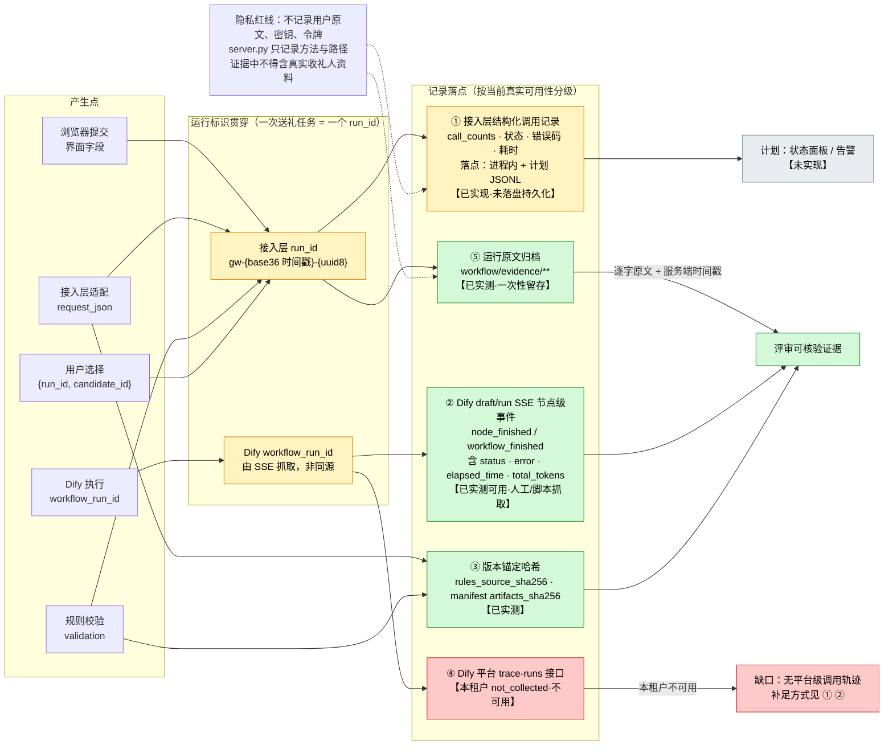

# 可观测性设计：字段、落点与替代路径

- 任务：ARCH-001（阶段 3）产出；**与 CLOUD-001（阶段 12/14，`deploy/` 归属部署 Agent）对齐**
- 日期：2026-10-30（北京时间）
- 对应评分规则赛道 B：**「可观测性证据：关键日志、运行状态、调用记录或指标；不要求所有项目采用相同监控方案」**，以及「工程完成度与 Demo 表现」中的日志/指标/追踪
- 范围：本文定义**字段与语义**（权威）；**部署侧采集实现**由 CLOUD-001 在 `deploy/` 与其自选文件名下落，引用本文即可，无需重复定义。

## 0. 命名与文件归属协调（避免与 CLOUD-001 冲突）

| 文件 | 归属 | 内容 |
| --- | --- | --- |
| `docs/architecture.md` | ARCH-001 | 架构主文档（含可观测性摘要 §7） |
| **`docs/architecture/observability.md`（本文）** | ARCH-001 | **字段、语义、落点、错误码分层**——权威定义 |
| `docs/architecture/diagrams/observability-flow.mmd` | ARCH-001 | 可观测性数据流图源 |
| `docs/architecture/rendered/observability-flow.svg` | ARCH-001 | 渲染产物 |
| `deploy/**`、`docs/observability-*.md`（部署线自选） | **CLOUD-001** | 采集落地实现、部署期日志、实测指标 |

约定：**部署线只引用本文的字段名，不另起一套字段名**；本文不修改 `deploy/` 下任何文件。文件名冲突由 PM 裁决（当前无冲突：架构线全部收在 `docs/architecture/` 下）。

## 1. 硬约束：本租户没有平台级追踪

**已实测事实（E1）**：该 Dify 租户的追踪接口返回未采集。

```text
GET /console/api/apps/<app_id>/trace-runs/workflow/<run_id> → 200
{"status":"not_collected","source_kind":"workflow","source_id":"0cdef527-…",
 "provider":null,"trace_id":null,"span_count":null,"error_code":null}
```

出处：`workflow/evidence/WF-002-2026-10-30.md`（20:20:58）与 `docs/test-reports/stage-c/acceptance-2026-10-30.md` §1.3（QA 独立复跑）。

**因此本方案的设计前提是：不可依赖平台追踪。** 一切"调用轨迹"证据必须由下面 §4 的替代路径自行产生。这也是本方案与"直接用 LangSmith/Langfuse 之类平台"的区别——平台追踪在**本租户不可用**，写进方案会成为无法兑现的承诺。

## 2. 一次送礼任务 = 一个运行标识

| 标识 | 格式（实测） | 产生点 | 作用 |
| --- | --- | --- | --- |
| `recommendation_run_id` | `gw-{base36 时间戳}-{uuid8}`，例：`gw-m9x2k1-a3f91c0e` | 接入层 `store.mjs: createRun` | **贯穿一次送礼任务**：推荐 → 选择 → 呈现。跨阶段唯一关联键 |
| `workflow_run_id` | Dify 生成的 UUID | Dify 执行时产生 | 关联单次 Dify 执行；**与我方 `run_id` 不同源，必须分别记录、不得混用** |
| `request_json` 哈希 | `sha256(request_json)` | 接入层 | 证明"选择的候选来自哪一份不可变请求"（**计划字段**，未实现落盘） |
| 候选版本 | `initial_candidates_json` / `candidates_json`（各配 `sha256`） | 接入层 / N7 | 区分"首检候选"与"修订后候选"，支撑 SC-7 与 N6 保护的可核验性 |

> **重要**：`recommendation_run_id` 是**服务端生成**的，不接受浏览器自定义。选择事件只允许携带 `{recommendation_run_id, selected_candidate_id}`。

## 3. 字段清单（按记录类型）

### 3.1 任务级记录（推荐报告，实测已存在）

| 字段 | 类型 | 语义 | 现状 |
| --- | --- | --- | --- |
| `recommendation_run_id` | string | 任务标识 | E2 已实现（内存） |
| `created_at` | string | ISO8601 **+08:00** 固定时区，避免现场时区歧义 | E2 已实现 |
| `mode` | `"mock"` \| `"dify"` | 数据来源必须显式披露，**不得让 mock 冒充真实** | E2 已实现 |
| `status` | `passed` \| `failed` \| `needs_input` \| `error` | 业务状态（与 HTTP 码分离） | E1/E2 |
| `repair_count` | `0` \| `1` | **全局已用自动业务修订次数**（跨两阶段合计） | E1（规则/包装层） |
| `remaining_repairs` | `0` \| `1` | `1 - repair_count` | E2 已实现 |
| `selected_candidate_id` | `null` | 推荐阶段**必须为 null**（SC-5 的可观测断言点） | E2 已实现 |
| `selectable_candidate_ids` | string[] | 通过校验且可被用户选择的候选；失败项不可选 | E1/E2 |
| `workflow_errors` | object[] | 包装层错误（`REPAIR_NOT_ALLOWED`／`PASSED_CANDIDATE_CHANGED`／`WORKFLOW_INPUT_ERROR`）；非空时即使规则通过也不可选 | E1 |
| `business_data_verification` | `"not_verified"` | **固定值**：没有真实商品数据源，不得声称验证实价/库存/送达 | E1 |
| `notices` | string[] | 面向人的显著声明（模拟模式、占位节点等） | E2 |
| `call_counts` | object | 见 §3.4 | E2 |

### 3.2 校验输出（`validation`，实测已存在）

| 字段 | 语义 |
| --- | --- |
| `status` | `passed`／`failed`／`needs_input`／`error` |
| `all_passed` | 三个候选全部通过才为 `true` |
| `errors[]` | **批次/请求级**错误：`{code, path, message}`，含字段路径 |
| `candidate_results[]` | 逐候选：`{id, passed, errors[], warnings[]}`；**`OVER_BUDGET` 等候选级错误在此，不在顶层** |
| `business_data_verification` | 固定 `"not_verified"` |

> **易错点（已实测确认）**：候选级失败时顶层 `errors` 可能为空。任何监控若只读顶层 `errors` 会把"失败"误判为"无错误"。断言必须同时读 `status` 与 `candidate_results[].passed`。

### 3.3 版本锚定字段（实测已存在，可复跑）

| 字段 | 出处 | 作用 |
| --- | --- | --- |
| `rules_source_sha256` | `GET /healthz`（`deploy/server.py`） | 规则 API 自证所加载的 `validator/rules.py` 版本 |
| `sources_sha256{validator/rules.py, workflow/labels.py, workflow/intake.py, workflow/runtime.py}` | `workflow/verify_local.py` 输出 / `manifest.json` | 规则与适配层的完整版本指纹 |
| `artifacts_sha256{code_node.py, intake_node.py, check_node.py, recheck_node.py, report_node.py}` | 同上 | Dify Code 节点所用生成物版本；与云端实读哈希（行尾归一化后）比对 |
| `format` | `python-source-not-dsl` | 明确生成物**不是 DSL**，不得声称可导入 |

**用途**：任何一条"校验通过"的结论都能绑定到确切的规则版本。这是在没有平台追踪时**最强的可归因手段**。

### 3.4 调用记录（`call_counts`，实测字段已存在）

| 字段 | 语义 | 现状 |
| --- | --- | --- |
| `recommend` | 推荐阶段模型调用次数 | **接入层（E2）**：mock 下计数，未接真实模型故为 0；**工作流侧真实调用已实测**（WF-003 §4.5：含 N5 修订共 10 次），但**不在接入层计数内** |
| `recommend_revision` | 推荐阶段修订调用次数 | **接入层（E2）**未接；**工作流侧真实修订 2 次已实测**（WF-003 §4.5 第 2 批） |
| `presentation` | 呈现阶段调用次数 | **未实现**；选择前必须为 0（SC-5 的可观测断言） |
| `presentation_revision` | 呈现阶段修订调用次数 | **未实现** |

模型调用总次数、token 与成本**必须分别记录**，不能沿用"全程一至两次"的粗口径。

### 3.5 耗时字段

| 字段 | 来源 | 现状 |
| --- | --- | --- |
| `elapsed_time`（节点级／工作流级） | Dify `draft/run` SSE | **E1 已实测可采集**：如 `node_finished.elapsed_time = 0.094046`、`workflow_finished.elapsed_time = 0.154` |
| `total_tokens`、`total_steps`、`exceptions_count` | Dify `workflow_finished` | **E1**：注入轮 5 例 `total_tokens = 0`；**真实模型轮 10 次调用合计 34,127 tokens**（WF-003 §4.5） |
| 分段耗时（intake／check／recheck／report） | 本地 `time.perf_counter()` | E2：阶段 C 已用 `time.monotonic` 记录；**本机 Windows 分辨率不足，须批量计时**（见成本性能清单 §2） |
| 接入层请求耗时（HTTP） | 计划 | **E3 未实现** |

### 3.6 错误码分层（必须按层记录，不得混为一码）

| 层 | 前缀/取值 | 示例 | 实现等级 |
| --- | --- | --- | --- |
| 输入适配层 | `INTAKE_*` | `INTAKE_INVALID_JSON`、`INTAKE_UNKNOWN_FIELD`、`INTAKE_UNKNOWN_LABEL`、`INTAKE_CONFIDENCE_MISMATCH`、`INTAKE_CLARIFICATION_REQUIRED`、`INTERNAL_ERROR` | E1 |
| 规则校验层 | 18 码 | `INVALID_JSON`、`INVALID_REQUEST`、`MISSING_FIELD`、`INVALID_TYPE`、`INVALID_AMOUNT`、`INVALID_CANDIDATE_COUNT`、`INVALID_CANDIDATE_ID`、`DUPLICATE_ID`、`DUPLICATE_CANDIDATE_CONTENT`、`UNSUPPORTED_CURRENCY`、`CURRENCY_MISMATCH`、`OVER_BUDGET`、`FORBIDDEN_TAG`、`FORBIDDEN_TERM`、`PREPARATION_TOO_LONG`、`UNKNOWN_FACT_REF`、`UNKNOWN_TAG`、`INTERNAL_ERROR` | E1（已实现，出处见 `workflow/workflow-spec.md`） |
| 工作流包装层 | 3 码 | `REPAIR_NOT_ALLOWED`、`PASSED_CANDIDATE_CHANGED`、`WORKFLOW_INPUT_ERROR` | E1 |
| 接入层 Dify 客户端 | `DIFY_*` | `DIFY_NOT_CONFIGURED`、`DIFY_NOT_PUBLISHED`、`DIFY_HTTP_ERROR`、`DIFY_BAD_RESPONSE`、`DIFY_TIMEOUT`、`DIFY_REQUEST_FAILED` | E2（实现完整，真实调用从未成功过一次） |
| 接入层契约开关 | 1 码 | `PURSUIT_CONTRACT_NOT_READY` | E2 |
| 传输层（HTTP） | 4 码 | `INVALID_PAYLOAD`(400)、`INVALID_JSON`(HTTP 200+业务 error)、`NOT_FOUND`(404)、`REQUEST_TOO_LARGE`(413) | E1（本次实测） |
| **选择/呈现阶段预留** | **7 码未实现** | `INVALID_SELECTION`、`STALE_RECOMMENDATION`、`UNTRUSTED_RECOMMENDATION`、`CANDIDATE_NOT_PASSED`、`PRESENTATION_INVALID`、`TOTAL_MISMATCH`、`REPAIR_LIMIT_REACHED` | **E3：代码中 0 命中（QA 逐项 grep 核实），仅设计预留** |

## 4. 落点与替代路径（按当前真实可用性分级）



（同图源：[`diagrams/observability-flow.mmd`](diagrams/observability-flow.mmd)；渲染：[`rendered/observability-flow.svg`](rendered/observability-flow.svg)）

### 4.1 ① 接入层结构化调用记录（**E2 已实现字段，E3 未落盘**）

- 字段：§3.1 全部 + §3.4 + §3.6 错误码 + 分段耗时。
- 目标落点（计划，未实现）：一行一事件的 JSONL，例：
  `logs/giftwise-runs.jsonl`，每行 `{ts(+08:00), run_id, event, mode, status, stage, elapsed_ms, error_codes[], repair_count, call_counts, rules_source_sha256}`。
- **不落盘是已知缺口**：进程重启即失去全部调用记录；当前只能靠报告响应与证据归档回看。
- 隐私：**不记录用户原文与备注原文**，只记录字段名、错误码、哈希与计数。

### 4.2 ② Dify `draft/run` SSE 节点级事件（**E1 已实测**）

这是当前**最有效的 Agent 链路轨迹替代证据**，且强于页面"上次运行"DOM（QA §1.6 的结论）：

| 接口 | 用途 | 注意 |
| --- | --- | --- |
| `POST /console/api/apps/<app_id>/workflows/draft/run` | 触发测试运行，响应为 **SSE** | 需页面上下文的 **CSRF** 头（实测：cookie 名 `__Host-csrf_token`，头名 `X-CSRF-Token`，缺则 401） |
| `GET /console/api/apps/<app_id>/workflows/draft/nodes/<node_id>/last-run` | 结构化读取节点末次运行 | 与 SSE 一致，可交叉验证 |
| `GET /console/api/apps/<app_id>/workflows/draft` | 实读草稿图与节点代码 | **必须以此为准，不能以界面显示为准**（自动保存有延迟） |
| `GET /console/api/apps/<app_id>/workflow-runs` | 页面自身发起的调用可用 | **由脚本直接 `fetch` 返回 401**（CSRF），属取证方法限制，**不是接口故障** |
| `GET /console/api/apps/<app_id>/trace-runs/...` | 平台追踪 | **本租户 `not_collected`，不可用** |

`node_finished` 事件字段：`node_id`、`node_type`、`title`、`inputs`、`process_data`、`outputs`、`status`、`error`、`elapsed_time`、`outputs_truncated`。
`workflow_finished` 事件字段：`status`、`outputs`、`error`、`elapsed_time`、`total_tokens`、`total_steps`、`exceptions_count`。

**限制**：这是**控制台草稿测试运行**接口，不是生产 API；生产路径是 `/workflows/run`（blocking），其轨迹在 `not_collected` 前提下**不可回查**。因此生产化的可观测性必须依赖 ①（接入层自记录）。

### 4.3 ③ 版本锚定哈希（**E1 已实测**）

- `GET /healthz` → `rules_source_sha256`（实测 `4782255b…`）。
- `python workflow/build_code_node.py` → `sources_sha256` + `artifacts_sha256`。
- 云端节点哈希与本地比对须**先做行尾归一化**（CRLF→LF），否则字节数会差"行数个字节"（WF-003 §3.2 已更正过一次不准确表述）。

### 4.4 ④⑤ 平台追踪与证据归档

- ④ **不可用**（`not_collected`）。若 PM 决定开启租户 trace 采集，本方案可直接复用同一 `run_id` 作为关联键（**未申请、未开启**）。
- ⑤ **已实测**：`workflow/evidence/**` 保存逐字原文、节点 I/O、SSE 原始 jsonl、截图与哈希清单。这是当前评审可直接核验的证据集。

## 5. 采集方式汇总（现状 vs 计划）

| 能力 | 现状 | 等级 |
| --- | --- | --- |
| 任务标识贯穿 | 已实现（内存） | E2 |
| 校验输出与错误码记录 | 已实现 | E1 |
| 调用计数 | 已实现（字段随报告返回） | E2 |
| 节点级耗时与 token | 可采集（SSE） | E1 |
| 版本指纹 | 已实现 | E1 |
| **容器内版本指纹一致性** | **已实测**：容器内 `/healthz` 的 `rules_source_sha256` 与本机 `validator/rules.py` 一致（独立复核） | E1 |
| 结构化日志落盘 | **未实现** | E3 |
| 指标聚合（P50/P95、错误率） | **未实现** | E3 |
| 面板／告警／阈值 | **未实现** | E3 |
| 采样策略与保留期 | **未定义（未知）** | U |
| 平台级追踪 | **本租户不可用** | 不可用 |

## 6. 隐私与安全红线（强制）

1. **不记录、不提交真实密钥、Token、密码**；`DIFY_API_KEY` 只从服务端环境变量读，不进前端、不进日志、不进仓库。
2. **不记录用户原文与备注原文**；`deploy/server.py` 的 `log_message` 只记录方法与路径（已实测）。
3. 证据文件不得包含真实收礼人资料；公开材料只用虚构人物与已脱敏数据。
4. 令牌只在页面内存中使用；证据中只记录"是否存在/长度/最终头名"，**从不记录令牌内容**。
5. 错误响应不回显用户原文与堆栈（`INTERNAL_ERROR` 已实现受控文案）。

## 7. 与 CLOUD-001 的交接项

| 交接项 | 内容 |
| --- | --- |
| 字段名 | 以本文 §3 为准；部署侧不得另起同义字段 |
| 采集落点 | 部署线决定（`deploy/` 内或部署期日志），本文不预设路径 |
| 需部署线实测 | 容器内日志落盘、日志轮转、采集开销（~~`/healthz` 版本指纹在容器内是否一致~~ **已实测：一致**——2026-10-30 22:5x 独立复核，容器内 `rules_source_sha256` = 本机 `validator/rules.py` 哈希，见 `docs/architecture.md` §10.6） |
| **`run_id` 命名空间（新增，须回填）** | 部署侧若按 `run_id` 聚合，**必须明确指接入层任务级 `recommendation_run_id`**（`gw-{base36}-{uuid8}`），**不得与 Dify `workflow_run_id` 混用**——两者不同源（§2）。归档/日志里应同时保留两者并各自标注字段名 |
| **成本与模型用量口径（新增，已核对一致）** | 部署线 `deploy/observability.py` 的 `cost {unit: CNY, amount: 0.0, source: "deterministic_rules_only"}` 与 `giftwise_model_calls_total 0` **与本文件一致**：规则 API 不调模型，故其成本恒为 0。**金额成本的全链路值仍记 `not_measured`**（无供应商真实账单），不得把该服务的 0 当作业务成本 |
| 容器化状态（新增） | **容器化已实测**（本机单一实例，9/9，见 `deploy/evidence/docker-2026-10-30.md`）；**云端部署、镜像仓库推送、多副本仍未发生**——本文件的"落点"设计对二者同样适用 |
| 需部署线回填 | 真实部署后的端口、时区（必须 +08:00）、保留期、采集方式 |
| 本文件不修改 `deploy/` | 遵守文件边界；如需调整 `deploy/`，由部署线执行 |
