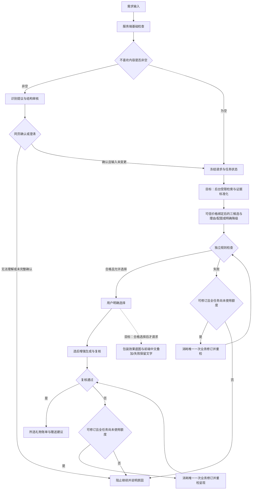

# GiftWise AI｜赛道 B 技术交付总文档

原整理时点：2026-10-31 11:13（北京时间）；本轮在独立 worktree 延续该本地文稿。状态：**七项正文与附件文案已整理供 PM 审查；产品仍在联调/验收，尚未最终交付冻结。**

本文件按产品负责人提供的比赛材料截图，将七项要求合并为一个阅读入口，含概要正文、证据和待办，不要求评委拼读几十份文件。附件和原始日志保留原路径，不移动、不删除、不改写历史数字。要求原文见 [赛道 B 规则](AI比赛评分规则-赛道B原文.md)。产品定位以 [Issue #1](https://github.com/sunnyyang0822-stack/GiftWise-AI/issues/1) 为权威。

> 检索与媒体方案同步（2026-10-31）：基于 release 提交 `3890aa57a2c728d3bd94fea00b9117f9d0a8aa93`。#59/#60 **方案已确定，正在实现和验证**；本轮仅内容同步，不修改共享架构源文件或 PPT 二进制。技术取舍见 §二新增支持说明，状态和最新 QA 见 [检索与媒体同步记录](检索与媒体方案材料变更记录-2026-10-31.md)。旧证据仍按原日期与版本解释。

## 本轮统一使用规则

**主线：帮助用户挑选礼物：送什么、为什么适合、如何比较和选择。** 规则提供可信保障，自动业务修订只作全任务最多一次的异常兜底；包装、贺卡和赠送方式是选定礼物后的增强服务。

本文的组件、状态和异常矩阵是设计要求/旧记录汇总，不作为本线已验证新版实现的声明。新版测试数字、功能完成状态、截图和真实模型端到端结论，必须等待 **QA 报告 → PM 审核 → 同一交付版本回填**。仅有模块自测、mock 或旧 Dify/镜像/浏览器结果不能升级结论。云部署、价格库存物流、真人排练、录屏与真实用户验证仍不宣称完成。

先读本文七项正文，再到 [PPT 页序与截图替换清单](PPT页序对齐与截图替换清单-2026-10-31.md) 对照当前候选。当前讲稿已按本地候选实际十一页顺序修订；候选二进制未改、未在本 PR 发布，也未批准为最终投影。

## 状态分类：实现与验证分别登记

| 标签 | 本文定义 | 可说与不可说 |
|---|---|---|
| 已实现 | 对应提交中存在实现，附源码/PR；开发自测与未审 QA 分别写明 | 不据“有代码”宣称用户全链路通过 |
| 已验证 | 指定版本、模式、范围有独立 QA 原始结果；对外完成结论仍待 PM 审核 | 模块/mock 结果不得扩成线上真实模型验证 |
| 计划中 | 契约或后续工作已明确但尚无实现/执行证据 | 不把目标图、计划时间当实测 |
| 受阻 | 明确存在前置缺口，登记原因、负责人和解除条件 | 不把受阻写成通过，也不将旧失败套用于新版本 |

最新已发表独立 QA：[PR #51 固定报告](https://github.com/sunnyyang0822-stack/GiftWise-AI/blob/902cbd4071d49a1acacce5841347452bb0512f75/docs/test-reports/final-qa-1031/report.md)，业务被测版本为 `3dfb186b74a4afabfef82c7213401fb60587f946`，报告实际模式为 mock。模块/HTTP 有通过证据，普通页面准备时间阻断且有其他字段、跨适配契约缺陷；完整浏览器 E2E 为 BLOCKED，真实 Dify/模型为 SKIP。该版本早于本轮 release，不能把其中旧失败直接判给当前版本，也不能因后续修复 PR 合入就判定回归通过。#59/#60 尚无对应新版独立 QA 结论；PR #61 的开发自测单独登记，不是验收。旧 [模块报告来源索引](status-review-2026-10-31/qa-source-index.json) 保留，不再充当最新报告入口。最终数字仍待 QA 同版复核及 PM 审核。

## 材料准备到哪一步了

| 比赛材料 | 已有内容 | 当前结论 | 交付前还缺什么 |
| --- | --- | --- | --- |
| 场景与价值分析 | 目标用户、痛点、选礼流程、差异化 | 正文已有，可继续优化 | 真人试用/价值验证尚无；不把产品假设当统计 |
| 系统架构设计文档 | 架构图、职责、选型、状态与部署说明 | 文档和旧版图已存在 | 新版识别确认与账单路径需同步最终图；不能沿用旧图宣称新版全部运行 |
| Agent 执行流程 | 推荐/校验/选择/呈现规范与旧 Dify 证据 | 新版代码和离线准备已有 | 前端收尾、最终集成版本、浏览器/E2E 和新版真实模型验证 |
| 异常处理说明 | 本文异常矩阵；架构文档异常章节；故障卡 | 说明已有 | 对最终版本逐项验收，明确失败/未测 |
| Demo 与代码仓库 | 仓库、README、可运行本地代码、旧素材包、PPT | 基础材料齐备，未最终冻结 | 最终复现、更新截图、真人排练；备用视频本轮未发现 |
| 成本与性能分析 | 旧版模型、规则、容器测量与方法 | 有历史证据，非新版测量 | 新版延迟/调用数待测；金额费用没有真实费率/账单依据 |
| 可观测性证据 | 运行状态、调用记录、规则指纹、日志/指标归档 | 有旧版证据和实现 | 最终新版贯通复核、脱敏检查；平台 trace 仍缺 |

**当前不是“没有材料”，而是“材料已有，版本和事实口径尚未统一冻结”。** 以下已实现/自测说明不能替代最终独立验收。

## 一、场景与价值分析

### 目标用户与真实问题

GiftWise AI 面向青年送礼者。场景优先级：恋人及追求对象最高，其次朋友，再其次职场上司、亲戚和家人。这里的“最高频”是产品定位优先级，不是实际使用频率统计；第三优先级关系不据此扩展本轮 MVP 已验收范围。核心问题是“不知道送什么、为什么适合、如何送出去”；用户从“不知道送什么”出发，希望知道礼物是否符合对方偏好、关系分寸、预算和准备时间，以及推荐依据是否可靠。追求对象不等于恋人，不假定双向好感或对方一定喜欢。

这些痛点是本项目的问题定义与产品假设，当前没有用户访谈样本、付费转化或真实使用频率数据；“最高频”仅表示产品负责人确定的场景优先级。

### 现有解决方式与不足

用户可以问朋友、浏览商品列表、搜索社交平台或向聊天模型提问。这些是常见可替代方式的分析，不是已完成的竞品实验：信息分散，需要自己比较；聊天建议中的事实、猜测和价格估计容易混在一起；通常仍需用户自己判断是否满足预算和禁忌。

### 本项目的改进

**主价值：帮助用户挑选礼物：送什么、为什么适合、如何比较和选择。**

低负担输入 → 三个不同礼物方向 → 解释事实依据、推断与未知 → 独立规则检查 → 用户自主选择 → 选定后的包装风格/色调、贺卡和赠送建议。

规则检查是帮助用户可信选择的保障；**自动修订只是候选失败时最多一次的异常兜底，不是主功能或主卖点**。包装等建议属于选礼后的增强服务。

本轮不新增虚构用户、市场样本或模拟推荐结果。正式场景说明只使用关系类型与选择维度；演示输入和候选以 QA 锁版记录为准，公开前脱敏。

参考：[产品需求](../product-requirements.md)。

## 二、系统架构设计文档

总览：前端输入 → API 接入与可信状态 → Dify 工作流/模型提供者 → 独立规则校验 → 结果比较与用户选择 → 选后包装风格/贺卡输出。此处是职责图，不代表线上模型已经验证。

### 核心组件和服务边界

| 组件 | 职责与理由 | 代价/边界 |
| --- | --- | --- |
| 中文 Web 界面 | 收集需求、比较三方案、确认与选择、账单展示 | 浏览器输入不可信，不能提交 passed 或修订计数作为结论 |
| Node 接入层 | API、模型适配、服务端快照、确认归属、幂等、选择与呈现编排 | 单进程内存状态，重启丢失，不支持多副本共享状态 |
| 独立规则代码 | 预算、币种、时间、必要字段、明确类别/字面词、事实引用校验 | Python 参考实现、JS 接入实现；样例一致不等于全域等价，不证明语义完整理解 |
| Dify + 模型 | 需求到候选的生成与受限修订；新版识别/呈现提示词已准备 | 旧工作流有真实记录；新版真实端到端尚未验证 |
| Docker 规则 API | 将规则服务打包、健康检查、非 root 和复现 | 现有镜像只包含规则服务，不是整站部署；旧镜像不能证明包含最新规则 |
| GitHub | 源码、文档、PR 审查和版本交付 | 需要冻结同一版本，不以本地未提交文件冒充远端交付 |

### 检索与图片为什么这样设计（支持说明，#59/#60）

**方案已确定，正在实现和验证。** 这些设计帮助用户理解“这个礼物为什么值得考虑、价格依据有多可靠”，不取代三方案比较与用户选择。依据：[Issue #59](https://github.com/sunnyyang0822-stack/GiftWise-AI/issues/59)、[Issue #60](https://github.com/sunnyyang0822-stack/GiftWise-AI/issues/60)；并行 [PR #61 固定版本契约](https://github.com/sunnyyang0822-stack/GiftWise-AI/blob/7204b64718420da2a737610aefec02fbdba02204/docs/design/retrieval-media-contract.md) 不等于已合入 release。

| 选择 | 为什么 | 代价与验证边界 |
|---|---|---|
| 后台 OpenCLI + 专用浏览器 | 用户只在网站填写与比较，智能体在受控后台获取商品证据；不要求用户装扩展、提供个人浏览器会话/Cookie 或打开搜索页 | 目标架构。后台需独立浏览器运行环境、连接与来源适配；服务器未部署。CLI 安装成功不等于商品检索成功 |
| 浏览器读取作为来源验证路径 | 能观察允许访问页面上的具体商品规格、报价和适用条件，补足模型估价的证据缺口 | 不是普遍优于官方 API；若有获准且稳定的官方 API 应评估。网站访问规则、登录过期、验证码、超时和页面改版带来维护成本；遇限制停止，不将绕过限制作为优势 |
| 浏览器/模型/服务端/规则分责 | 浏览器获取证据；模型解释适配理由；可信服务端按商品 ID 绑定规格、来源与价格；独立代码检查确定约束 | 模型不得降价以通过预算；网页文字属于不可信数据，不能成为系统指令。绑定和隔离仍需同版 QA，不能只靠提示词保证 |
| 三候选各配图，选择后才生成包装图 | 商品图辅助识别与比较；包装是用户选定合格礼物后的增强，避免为未选方案生成无用图片和增加等待 | 减少无用生成与等待是设计动机，节省比例、延迟和成本均未实测。PM 已完成一次 ModelVerse/Seedream 纯文字生图请求；接口返回不等于视觉通过、产品接线或真实 SKU 包装图，产品 provider/参考图能力与费用仍待验证 |
| 底图与中文标注分开 | 图像服务生成效果底图，前端以 SVG/HTML 叠加中文箭头和说明，便于修改、窄屏放大与提供无障碍文字等价 | 需验证归一化坐标、缩放指向和可读性；支持参考图的能力须实测，不能仅凭提示词承诺外观一致 |

目标职责链：用户网页 → API/可信任务 → Dify/智能体受限检索计划 → 后台 OpenCLI/专用浏览器 → 商品证据标准化与价格绑定 → 模型适配理由 → 独立约束校验 → 三候选/来源/图片 → 用户选择 → 选后文字与包装效果图。媒体作为独立 sidecar，不擅自修改严格候选 JSON；该链路是设计，非服务器真实运行结论。

#### 预算约束不等于价格证据

代码能验证给定估价数字是否超预算，不能证明实际能按该价格买到。预算输入只是约束，不是价格来源。每个价格应绑定商品 ID、规格、数量、币种、来源、读取时间、价格条件和证据引用；搜索摘要/链接本身不等于已读取详情。

| 来源 | 应怎样说明 | 不能据此宣称 |
|---|---|---|
| 页面观察价 browser_observed | 对应规格、页面来源、读取时间、普通/券后/会员等条件；仅为当时页面观察 | 结算价、库存或送达保证 |
| 用户报价 user_provided | 用户提供，注明来源与适用条件未独立核实 | 浏览器已读取或官方已核实 |
| 种子参考价 seed | 估算·非实时价格，保留参考来源与日期 | 当前可买到或实时成功 |
| 模型估价 model_estimate（说明层分类） | 仅模型推测，不能冒充商品证据；#60 sidecar 无此枚举时按契约使用 unknown，不自行加机器字段 | 真实报价或预算已核实 |
| 价格未知 unknown | 金额为 null，明确未知/需澄清 | 不得填 0 或显示预算已核实；0 元合法输入与未知价格不同 |

条件价适用性不明或区间跨预算时，不能判“预算已核实”；区间按上端点筛选。三个备选不相加，预算只计所选礼物；包装等不计预算也不等于免费。页面报价仍不保证结算价、库存或送达，business_data_verification 维持 not_verified。

#### 图片的证据边界

候选优先使用与具体 SKU/规格相符且有使用依据的来源图；公开可见不等于获准转载。白底高清是视觉目标，准确性优先于白底风格。通用预览素材标“样例”；AI 图标“AI效果示意，非商品实拍”，不能冒充对应 SKU 实拍。图片不能证明材质、成分、过敏安全或价格真实。选后包装图以已选候选和可用参考图为依据，未验证参考图支持就不承诺外观一致；图片失败保留已有文字结果。

#### 新方案状态（不与旧成果合并）

| 范围 | 已实现 | 已验证 | 计划中 | 受阻/缺口 |
|---|---|---|---|---|
| 后台检索与可信价格绑定 | PR #61 固定版本有受限 worker、证据/价格绑定、安全读取与 sidecar 实现；未合入本轮基线 | 仅开发自测：专用浏览器读取公开练习站、固定 Apple 中国详情观察价及受控夹具；非独立 QA、非结算保证 | 通用来源搜索与三种不同商品覆盖、工作流检索计划与前端同版接线、独立复核 | 已有固定 Apple 中国商品详情 CNY 页面观察记录；真实通用搜索/三种不同商品覆盖仍缺，服务器部署未执行 |
| 三候选商品图 | PR #61 有媒体信封及缺图状态；前端并行实现不据此判完成 | 无新版真实 SKU/授权图独立验收 | 三候选逐项绑定、来源标识、窄屏/无障碍复核 | 缺真实图来源和使用依据，不能伪造图片 URL |
| 选后包装图与中文标注 | PR #61 有 provider 接口、选后门禁与缓存；不等于实际出图 | 有 PM 单次纯文字生成记录，视觉未通过；无外观一致性/标注独立验收 | 服务选型、参考图能力、前端叠加与幂等验收 | 产品服务接线、参考图能力与费用账单仍缺；本线不作新调用 |

开发证据：[PR #61 交付报告](https://github.com/sunnyyang0822-stack/GiftWise-AI/blob/7204b64718420da2a737610aefec02fbdba02204/docs/research/opencli/delivery.md)。须读其文末补证：固定 Apple 中国详情已有 CNY 页面观察记录，两种规格仍是同一种礼物，不能凑三方案；目录搜索失败仍保留。详情读取不等于通用搜索、三候选或结算核实。通过 OpenCLI 安装包 CDPBridge 的读取也不能改写成 CLI browser 命令已成功：同报告的 CLI open/extract 仍要求扩展。价格引用门禁已有 PR 实现，但工作流同版适配/真实模型闭环尚未验证。不是“只有 CLI 安装”也不是“真实检索已完成”，以各路径实际证据分别解释。

### PM 单次生图补证：五种状态独立登记

2026-10-31 补证见 [Seedream 首图工程记录](seedream-review-2026-10-31/README.md)。接口连通：PM 经 UCloud ModelVerse 请求 doubao-seedream-4.5，返回模型 doubao-seedream-4-5-251128；一张 2304×1728，8.813 秒，usage.generated_images=1、output_tokens=15552。来源 JSON 和图片已检查并复制留档，原件未动；服务/日期归属据 PM 说明，摘要无端点/请求 ID/时间戳，不冒称供应商完整日志。

**接口返回成功；视觉未通过；产品接线待实现/验证；独立 QA 待执行；部署未验证。** 纯文字虚构钢笔造景，无真实商品参考图，不能证明 SKU 外观保持。包装边缘裁切、礼物比例不理想且无箭头，不作最终产品截图。8.813 秒仅单次生图请求，不是全站耗时或性能统计；费用无账单核实。

选型先看参考图和完整造景能力，再用实测决定；本次不证明参考图支持，不宣称模型排名/最优。推荐三图用白底/近白底商品图，选后包装图有完整造景；底图与手写风格中文箭头分层，窄屏提供文字等价。IMG-01 的构图/比例问题作为失败案例保留，修正与复验均待执行，不能用“已生成”掩盖视觉不足。

### 新版目标链路示意




该图表达新版设计和代码职责，**不表示所有边都已通过真实模型与浏览器验收**。不虚构数据库、Kubernetes、微服务集群或云资源。

已有赛道 B 架构附件：[架构图 PNG](架构图-GiftWise.png)。它是旧版 11 节点工作流图，需与新版目标图区分。

架构取舍：先保持单实例和最小职责边界，减少黑客松配置负担；将来若扩展多副本，必须先解决共享状态、持久化、幂等和认证，不能仅增加容器数量就宣称弹性架构。UCloud 是候选部署环境，未部署；FastAPI/K8S/数据库当前不因材料要求而新增。

详细依据：[架构设计](../architecture.md)、[部署说明](../../deploy/README.md)、[预发方案](../../deploy/preprod-plan.md)。

## 三、Agent 执行流程

1. 收集关系、场合、预算区间、准备时间、兴趣与可信度、风格、不喜欢和补充说明。选择“其他”需说明具体关系/场合；其他金额填写区间。前后端一致性仍待最终验收。
2. 基础字段校验；预算仅礼物本身；新版要求用 0–1000 元双端滑条，仅“其他金额”可自由填区间且最高 10000 元；不确定先澄清。0 元表示礼物本身不新增支出，不能把需购买材料写成免费。六档时间映射 1/5/7/30/90/365 天，并显示实际检查上限。
3. 非空“不喜欢”先识别；模型输出需严格结构、原文依据和白名单检查。无法可靠识别则澄清，不能当作没有限制。mock 只是固定数据，不宣称通用语义理解。
4. 用户确认后，服务端验证分析 ID 与当前输入一致，合并已确认项并冻结请求；模型不能改预算、天数和明确约束。
5. 目标新增后台商品检索与证据标准化，再生成三个不同礼物方向及适配理由，独立代码检查。真实来源不足三个时明确不足/澄清，不凑商品；可提供明确标识的参考方向，但不是三件已核价商品。失败候选不可选择；低于预算下限仅警告，超过上限拒绝。价格缺失/条件不明不能标预算已核实。
6. 只有失败且可修订才进入最多一次自动业务修订；不是每个任务都必须修订。推荐与呈现共享额度，不因页面重试或用户选择而重置。
7. 用户自主选择合格候选，服务端校验运行和候选归属；选择前不生成详细呈现。
8. 生成并复核包装风格色调、贺卡和赠送方式；账单只计所选一个礼物的估价。包装不报价、不计入礼物合计，不等于免费；价格、库存与送达均未核实。

上下文与状态：用户明确知道的兴趣才进入 facts；推测单独保存，未知不生成事实。请求、候选版本、分析快照、选择和修订计数由可信服务端持有；浏览器不能自行确定 passed。进程内状态并非持久化或多用户认证系统。

工具调用：模型负责提出方案；确定性 Code/JS/Python 校验负责检查；服务端 API 负责确认与幂等。开发协作中的多个 Agent 不等于产品运行了多 Agent 系统。

依据：[工作流规范](../../workflow/workflow-spec.md)、[旧 Dify 真实证据](../../workflow/evidence/WF-003-2026-10-30.md)。新版提示词/生成物以最终集成版本为准，不把旧证据迁移为新版成功证据。

## 四、异常处理说明

| 情况 | 处理与用户反馈 | 重试/恢复与边界 |
| --- | --- | --- |
| 检索失败、登录失效/访问限制、超时 | 明确 unavailable/原因，停止受限来源访问；维护者在专用后台处理连接 | 单 worker、有界队列、超时/取消与任务清理是目标；不无限重试、不复用用户个人会话 |
| 条件价不明、价格未知或证据不足 | 标未知/待澄清；不填 0，不判预算已核实 | 可用显著标识的用户报价/种子参考数据，不冒充实时读取 |
| 有据商品不足三个 | 返回 partial/不足原因与下一步 | 不编造商品、价格或图片补足数量 |
| 商品图片缺失、包装生成失败 | 缺图/failed/unavailable 明示，保留文字结果及可访问说明 | 不造成功图；重复请求幂等需实测，不绕过一次业务修订上限 |
| 网页指令/任意命令/跨任务证据 | 外部内容按数据处理；拒绝任意 shell/eval 与错任务/过期 ID | 端口仅本机/受控私网，密钥服务端保管；隔离、防内网下载等均需 QA，不因文案而宣称生产安全 |
| 预算、场合等信息缺失/非法 | 返回 needs_input 和中文原因，不默补 | 用户修改输入；其他关系/场合须明确说明 |
| 识别零结果、未映射、输出不合规 | 拒绝采用识别包，要求澄清 | 不静默放行，不自动重试模型；用户编辑后重新分析 |
| 模型服务未配置或调用失败 | 报服务错误，不能把 mock 冒充真实 | 基础设施层不自动重试，避免重复计费 |
| 候选 JSON 损坏、字段/数量不符 | 严格解析拒绝；不剥离 Markdown 伪装合法 | 仅在允许路径使用一次业务修订；失败后停止 |
| 超预算、超期、明确禁忌冲突 | 失败项不可选，给出规则原因 | 最多一次修订；仍失败则人工调整，不能自动改选 |
| 超时 | 中文等待/超时提示，不展示为成功 | 前端等待阈值与服务端超时不同；前端中止不证明模型未计费 |
| 分析快照过期、输入变更或伪造确认 | 拒绝旧确认，重新分析 | 分析快照设计 10 分钟；实际边界须由 QA 执行 |
| 重复确认/重复选择 | 服务端复用已有结果或 in-flight 任务 | 并发/失败后的幂等须实测，不能只凭设计成立 |
| 进程重启、运行记录丢失 | 明确记录不存在，要求重新开始 | 不宣称可恢复原任务；持久化尚未实现 |
| 呈现未通过复核 | 不作为可执行成功账单展示 | 不降低原礼物价，不二次超额修订，交用户调整 |

人工介入是用户澄清、重新选择或手动重新发起；不是后台人工坐席。旧版字面匹配存在否定/同义表达局限，AI 锚定也只能证明文字来源，不能证明理解正确。

详细参考：[故障处置卡](../demo/故障处置卡.md)、[架构异常处理章节](../architecture.md)。以上策略的新版实际 PASS/FAIL 需最终 QA 补齐。

## 五、Demo 与代码仓库

仓库：[GiftWise-AI](https://github.com/sunnyyang0822-stack/GiftWise-AI)。源码入口：web/public、web/server、validator、workflow、deploy；说明见 [README](../../README.md)。核心路径：[前端](../../web/public/)、[API/任务状态](../../web/server/)、[工作流](../../workflow/)、[独立规则](../../validator/)、[部署](../../deploy/)。部署说明只说明复现/设计，不能作为已部署证据。

下面仅为可复制的启动步骤，本线未重新执行，不保证未冻结副本已可完整演示。

本地界面需要 Node；规则工具使用 Python 3.12 标准库；Docker 仅容器路径需要，真实 Dify 需要可信服务端配置。不要把 Python 规则 API 地址当作网站地址。

```powershell
# 在最终验收的仓库副本根目录启动；端口须确认未占用
$env:GW_MODE="mock"
$env:GW_HOST="127.0.0.1"
$env:GW_PORT="18887"
node web/server/server.mjs
```

另有 [启动脚本](../demo/bin/servers.sh)，只使用它实际打印且确认来自被测副本的端口。GET /healthz 与 /api/config 核对身份和 mode。最终应先锁定提交版本再演示；本文件不硬写动态分支 tip，交付时附 git rev-parse HEAD 输出或版本快照。

### 3 分钟 Demo 计划（与主脚本、分镜统一，未实测）

| 时间 | 内容 | 证据边界 |
| --- | --- | --- |
| 0:00–0:25 | 追求对象关系场景（不设人物）与模式声明 | 不假设互有好感；模式 A/B/C 以主脚本定义为准，未验证不称新版真实调用 |
| 0:25–1:00 | 输入关系、礼物预算、时间、偏好，必要时识别确认 | 等 PM 审核 QA 后使用对应界面；不沿用旧预算、手填天数或排除项图 |
| 1:00–1:45 | 三个礼物、理由与取舍；简看价格来源/条件和商品图标识 | 图片和检索仅展示获审范围；缺图保留文字，未知价不填 0；不把 mock/练习站当真实商品 |
| 1:45–2:35 | 用户选择合格方案，选后增强与单礼物账单；获审才展示包装效果图/标注 | 未选不出包装图；服务未授权或失败保留文字并说明状态；包装不报价且非免费 |
| 2:35–3:00 | 一条已批准范围的拒绝/失败路径，回到用户选择与边界 | 最多一次修订只作兜底；构造失败不冒充模型自然违规，旧归档不证明新版 |

时间段只是设计预算，加载也计入，最终等待阈值与真人计时另验。

兜底：[离线回放](../demo/replay/offline-replay.html)、[素材清单](../demo/pack/MANIFEST.md)。旧包有 24 张 PNG，未重新生成新版截图；缺图见 [MISSING](../demo/pack/MISSING.md)。历史 Dify 输出可以引用，但必须说“已归档运行，本次未调用”。

## 六、成本与性能分析

本节引用已有归档，**本次整理没有重跑性能或模型测量**。新检索/图像链路的费用、浏览器内存/CPU、队列等待、来源失败率、图片等待与端到端分位延迟均待测。先选后出包装图、单 worker 限流和幂等是设计取舍，无节省比例实测；不得填 0 或引用旧链路作为新性能。

| 指标 | 历史证据 | 可表达的结论与限制 |
| --- | --- | --- |
| 模型调用/token | 主批次 10 / 34,127；累计 13 / 38,326 | 旧 Dify 运行统计，不是新版调用数，也不推断当前精确剩余额度 |
| 模型链路端到端 | 旧归档约 5.2–8.9 秒 | 非新版浏览器到最终账单完整耗时，不能外推 p95 |
| 规则耗时 | 规则纯计算测量有归档 | 规则快不代表模型生成快；需说明机器、样本与有无网络 |
| 容器 | 旧交付镜像 177,918,474 B，169.676 MiB；启动均值 0.668 秒 | 旧规则容器本机基线，不是整站/云性能；新版需重建核对指纹 |
| 构建耗时 | 10-30 基线 1.720 秒；10-31 重建 3,662 ms | 两次条件不同，不能据此宣称优化比例 |
| PM 单次生图请求 | Seedream 返回一张 2304×1728，8.813 秒；generated_images=1、output_tokens=15552 | 仅本次请求摘要，不是全站 E2E、统计或实测成本；视觉未通过，详见首图记录 |
| 金额费用 | 供应商单位费率/账单没有确认 | 费用未测，不能填 0 或虚构单任务成本 |

成本方法：每任务按识别、推荐、推荐修订、呈现、呈现修订分开记录调用数；有供应商证据后按输入/输出 token 与对应单价计算，再说明网络/云资源费用。模型修订合计最多一次不等于整个任务只调一次模型。幂等、不自动基础设施重试和空输入跳过识别可减少重复调用，但节省比例未测。

瓶颈与优化方向：模型/网络等待、串行调用和前后端超时不匹配优先实测；其次排查重复请求、输出长度与状态一致性。先测最终任务的实际耗时和错误分布，再考虑缓存/并发；不拿单机压测当生产容量。

详细数据与方法：[成本性能指标](../architecture/cost-performance-metrics.md)、[镜像重建证据](../../deploy/evidence/image-rebuild-n1n4-2026-10-31.md)。

## 七、可观测性证据

需要解释一次任务经过哪些阶段、失败在哪里、用户选了哪个候选以及用了几次修订，而不是单纯显示“成功”。

- 任务标识、候选版本、批次与逐候选检查结果、错误码、选择、修订额度和分阶段调用计数由服务端产生和记录。
- mode 明确 mock/dify；business_data_verification 固定 not_verified。tokens 只记录平台实际返回，缺数据则未知，不估造。
- 规则源码与生成物指纹用于绑定运行版本，不能只看“健康检查 200”就认定业务成功。
- 公开日志不写用户原文、密钥、令牌或供应商配置；公开证据只用虚构/脱敏输入。
- 新方案待验收的观测项：检索任务 ID、来源与读取时间/条件、证据及商品/候选/图片绑定、队列/超时/取消、图片状态、失败与降级原因、阶段调用和真实费用；公开记录须脱敏，不含 Cookie 或原始私密描述。
- 现有内存任务状态不是跨重启持久化日志；Dify 平台 trace 不可用，不虚构完整分布式调用链。
- 独立可观测入口有本机/容器历史验证，默认规则入口 /metrics 不暴露；可观测入口未鉴权，不能直接公开。

| 证据 | 路径 | 使用限制 |
| --- | --- | --- |
| 字段与语义规范 | [observability.md](../architecture/observability.md) | 与最终服务端实际字段对齐后引用 |
| 日志/指标采集与历史测试 | [采集说明](../../deploy/observability-collection.md)、[历史证据](../../deploy/evidence/observability-2026-10-30.md) | 旧版/旧镜像证据；不自动证明新版 |
| 工作流调用归档 | [WF-003](../../workflow/evidence/WF-003-2026-10-30.md) | 区分无模型注入轮与真实模型轮 |
| 最终独立 QA | 已有 PR #51 固定旧业务版本的 mock HTTP/浏览器报告，最终集成仍受阻 | 等 PM 审核；模块报告不替代最终浏览器/E2E |

## 附录 A：答辩附件统一入口

| 附件 | 本轮入口 | 当前状态与剩余工作 |
|---|---|---|
| 当前本地 PPT 候选 | 主工作区 `docs/competition/答辩PPT-GiftWise-最终答辩版-2026-10-31.pptx`；[只读解析证据](page-alignment-2026-10-31/ppt-page-text.json) | 11 页、57,902 B，未修改/未加入本 PR；不是已批准冻结版，尚待逐页视觉终检 |
| 页序与截图替换 | [逐页差异表与 SC01–SC10 清单](PPT页序对齐与截图替换清单-2026-10-31.md) | 指出 P3–P9 旧版本标签/数字与新版证据的差异；新图尚未制作 |
| PPT 文案骨架 | [骨架](答辩PPT骨架.md) | 按当前十一页编排，不再沿用八页建议；不等于 PPT 二进制已同步 |
| 五分钟讲稿 | [逐页讲稿](../speech/讲稿-5分钟-2026-10-31.md) | S1–S11 对齐实际标题；设计预算合计五分钟，未真人掐表；旧 TTS 不适用 |
| 三分钟 Demo | [主脚本](../demo-script.md)、[分镜](../demo/分镜计时表-3min.md) | 挑什么/为什么/怎样比较与选择为主；A 在线、B 归档、C 离线，均明确证据准入 |
| 问答 | [30 题](../qa-prep/30题问答.md)、[红线](../qa-prep/红线话术与兜底动作.md) | 新预算/包装计价、模式和完成门禁统一；新数字待 PM 审核 QA |
| 本轮文案审查 | [待核实清单](文案修订与待核实清单-2026-10-31.md) | 首轮文案审查留存；本轮在文末追加统一入口与页序时点注 |
| 历史审查报告 | 主工作区 `答辩材料-事实审查报告-2026-10-31.md`、`答辩材料-事实审查续报与PPT优化记录-2026-10-31.md`；[只读来源哈希](copy-review-2026-10-31/reviewed-sources.json) | 原文及原数字未修改；尚未在本 PR 基线入库，不伪造远端附件链接；旧状态不直接作为新版结论 |
| 视频/真人排练 | 待实际制作/记录 | 录屏、真人排练与真实用户验证未完成；旧截图/TTS 不能替代 |

本地候选 SHA-256：`2cea6be9e9099fd78c5f22e4a349b372964a4bee2c89128e9db45a5cf4ec8089`。指纹只标识文件，不是最终产品提交 SHA。保留原件与所有旧版本，PM 冻结后只明确指定一个正式投影；本轮不提交任何 PPT 二进制。

### 七项材料—当前页序—附件定位

| 七项正文 | 当前 PPT 页 | 讲稿/问答/Demo | 审核门禁 |
|---|---|---|---|
| 一、场景与价值分析 | 1–3 | S1–S3、QA 1–18、Demo 主场景与三方案 | 不新增人物/市场样本；不作真人验证；实际输出待审 |
| 二、系统架构设计 | 4、6 | S4/S6、QA 23–26 | 新图待 PM 对 QA 范围审核，不把设计边当运行边 |
| 三、Agent 执行流程 | 3–4、10 | S3/S4/S10、QA 19–24、选择 Demo | 模块、本地/mock、真实模型分别验收 |
| 四、异常处理 | 6、9–10 | S6/S9/S10、QA 20/27、Demo 末段 | 当前失败案例与恢复行为待审 |
| 五、Demo 与代码仓库 | 10–11 | S10/S11、QA 27/30、主脚本与分镜 | 同一交付版本、真实来源与可运行范围 |
| 六、成本与性能 | 7 | S7、QA 28–29 | 新数字待测/待审；旧数字只作历史 |
| 七、可观测性证据 | 5–6、11 | S5/S6/S11、QA 26/28 | 原始输出、版本指纹、隐私与范围待审 |

## 附录 B：剩余任务与负责人

| 顺序 | 任务 | 负责人 | 完成判据 |
| --- | --- | --- | --- |
| 可并行 | 整理七项正文、证据和边界 | 材料 Agent 提交，PM 审查 | 本文稿已整理，不等于产品验收；历史来源与未入库附件明确 |
| 可并行 | 前端“其他”字段/选礼主叙事收尾 | 前端、接入 | 各自 PR 自测、PM 复核；字段前后端一致 |
| 可并行 | 模块/API 独立验收 | QA | 被测版本与原始输出明确，失败交负责人修复 |
| 可并行 | PPT/讲稿/问答文字对齐 | 答辩材料 Agent | 已对齐候选实际十一页，待 PM 审查；未改二进制、不填新版通过数字 |
| 集成后 | 锁定版本，浏览器和端到端验收 | QA、PM | 不混用不同 worktree 结果；正常/失败/账单/其他字段均有证据 |
| PM 审核 QA 后 | 更新图、截图、完成状态与测试数字 | 架构/工作流、材料 Agent | 同一版本、同一口径；新生成物与源码指纹对上 |
| 冻结前 | PPT 目视终检、真人计时、Demo 排练 | 产品负责人 | 在实际电脑 PowerPoint/WPS 打开；记录真人耗时和故障切换 |
| 提交前 | 脱敏、代码快照、附件选择、远端文件复核 | PM | 按规则于 11-01 10:30 前正式提交；上传动作另记录实际结果 |

本文件本轮纳入材料分支的非空 PR，等待 PM 审查，不自行合并。后续 Agent 应在各自独立 worktree 提交真实非空 PR，不能覆盖他人材料、改写历史记录或自行部署/消耗模型额度。新版真实 Dify、云部署、价格库存物流、真实用户验证均不得因“材料写齐”而宣称完成。

本轮实际文档检查及复现方法见 [validation.txt](page-alignment-2026-10-31/validation.txt)。只做文案、链接、源文件指纹和页序核对，不运行模型/产品套件，不以检查通过推定新版功能通过。

## 本轮交付及待现场补充

详见 [逐份修改与现场补充单](材料交付与现场补充项-2026-10-31.md)。本轮不新增人物/市场数据，不更改历史技术结论、不复制旧测量为新结果；最终数字依 PM 审核 QA 报告再回填。

## 最新事实同步（2026-10-31 PM 口径）

本节覆盖前文较早的准备状态；原日期、SHA 和历史证据不改写。

| 能力 | 当前事实 | 对外状态 |
|---|---|---|
| 后台检索 | PR #61 已合入；后台专用浏览器真实公开检索过三种商品，并绑定 CNY 参考价 | 已实现并有开发/运行证据；不是所有场景、结算价、库存或送达保证；仍需最终同版 QA |
| Seedream 4.5 | 已完成一次真实图片接口验证，接口可用 | 接口连通已验证；完整视觉、商品参考图保真、包装比例与箭头定位待验收 |
| 工作流/前端 | 尚未形成最终统一 E2E 通过证据 | 待同一提交、同一模式、独立 QA 复核 |
| Dify | 曾因 intake_json 字段不匹配返回 HTTP 400 | 受阻；修复字段契约后才能再次验证，不把旧成功或修复声明写成新版通过 |
| 云部署 | 本轮无新部署证据 | 未完成/未验证 |

目标职责仍是：用户只操作网站；后台浏览器负责检索；模型解释适配理由；可信服务端绑定商品、规格、来源和价格；独立代码检查预算与约束；Seedream 在用户选定合格礼物后提供包装造景底图；中文箭头和说明由前端叠加。图片失败保留文字结果并明确状态，不能伪造成功。

价格是页面观察价或参考价，不保证结算、库存和送达。图片接口成功不等于产品完成；没有参考图保真、最终箭头和统一 E2E 证据时，不替换正式截图。
