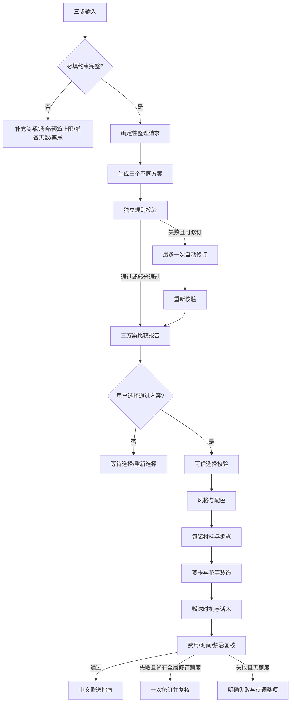
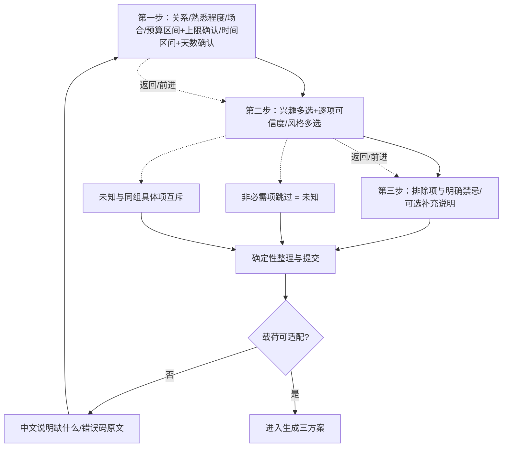
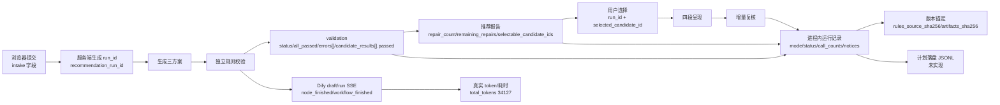

# 产品流程与状态

- 文档状态：**阶段 2 已冻结（2026-10-30，北京时间）**
- 本次修订：2026-10-30，Issue [#11 PRD-001](https://github.com/sunnyyang0822-stack/GiftWise-AI/issues/11)「阶段 2 收尾——低负担输入与可观测性验收项收编，四份文档定稿」
- 收编内容：低负担输入子流程（G-1）、运行记录与可观测性流向（G-2）
- 适用边界：以下流程是**设计约定**。`web/` 以 **mock** 运行；Dify **未发布**（`draft`，`toolPublished: false`）且**呈现阶段未实现**；**云未部署**；价格与库存**未核实**。流程各节点“是否已被真实证据验证”见 [`acceptance-criteria.md`](acceptance-criteria.md)。

## 主流程

## 低负担输入子流程（G-1 收编，来源 Issue #3）

规则要点（每条都有对应验收编号，见 [`acceptance-criteria.md`](acceptance-criteria.md) §4）：

1. **进度与返回**：步骤进度可见；返回上一步后已填内容不丢失（对应 AC-I-13）。
2. **可跳过**：非必需项跳过视为未知——`interests: []`、`interest_confidence: {}`，不生成事实、不按性别／年龄／关系／职业推断（AC-I-03）。
3. **可取消**：取消选择后提交的载荷与“从未选择”等价，不残留未知标签、不静默映射（AC-I-02）。
4. **未知互斥**：“暂时不知道／不确定”与同组具体项不得同时成立（AC-I-04）。
5. **不静默补值**：预算上限、币种、最终天数必须明确展示与确认；“不着急”等在严格校验前必须确认具体天数（AC-I-08）。
6. **中文可理解**：加载、空状态、错误、缺信息、无效响应均给中文原因与下一步；机器错误码保持原文（AC-I-06）。
7. **模拟模式标识**：模拟模式必须显著标识；浏览器与仓库不得持有真实凭证（AC-I-07）。
8. **窄屏与键盘属 P0**（AC-I-11、AC-I-12）。

> **诚实标注**：第 1、8 条与第 4 条的**界面控件行为当前不可核查**——`web/` 中有实现（进度与返回按钮文案「返回第一步」「返回第二步」见 `web/public/app.js`；响应式断点与 `prefers-reduced-motion` 见 `web/public/styles.css`），但仓库没有 DOM／浏览器自动化，前端也未在真实浏览器走查。原因与解除条件见 [`acceptance-criteria.md`](acceptance-criteria.md) §6 A-04／A-05／A-06。

## 页面状态

| 状态 | 用户可见内容 | 允许操作 |
|---|---|---|
| `input` | 三步输入、预算／时间确认；进度与返回；非必需项可跳过 | 编辑、返回上一步、跳过、提交 |
| `needs_input` | 缺少或无法理解的字段及中文说明 | 补充或修改 |
| `generating` | 正在生成三个方案 | 等待；不可重复提交 |
| `checking` | 正在进行独立规则检查 | 等待 |
| `recommendation_ready` | 三个方案、事实／推断／未知、费用、时间、检查结果 | 选择通过项 |
| `recommendation_partial` | 部分方案通过，失败项及原因 | 仅选择通过项 |
| `repairing` | 正在进行唯一一次自动修订 | 等待 |
| `recommendation_failed` | 无可选方案或修订仍失败 | 修改输入或重新开始 |
| `waiting_selection` | 已有合格方案，尚未选择 | 选择一个；不生成包装 |
| `selection_rejected` | 选择来源、版本或通过状态无效 | 刷新推荐或重新选择 |
| `presenting` | 按顺序生成风格、包装、贺卡／装饰和赠送方式 | 等待 |
| `presentation_failed` | 新增费用、时间、禁忌或结构不合格 | 查看待调整项 |
| `completed` | 可执行赠送指南及未验证事项 | 重新开始 |
| `infrastructure_error` | 模型、Code 或服务暂不可用 | 稍后重试；不视为通过 |

状态说明：

- `selection_rejected` 中**“选择来源无效”“通过状态无效”“候选未通过”**已有可核查实现与证据（`web/server/`；冒烟第 29、30、51 项）；**“旧版本／陈旧推荐被拒”尚未实现**（`STALE_RECOMMENDATION`／`UNTRUSTED_RECOMMENDATION` 全仓 0 命中），因此该状态**当前不可核查**，见验收标准 §6 A-03。
- `presenting` 及之后的状态在 `web/` 为 **mock 实现**；Dify 侧**未实现**，不得读作已具备真实链路。

## 运行记录与可观测性流向（G-2 收编）

**字段语义的唯一权威是 [`architecture/observability.md`](architecture/observability.md)**；本节只描述流程上的产生点与流向。采集实现归属阶段 14（Issue [#10](https://github.com/sunnyyang0822-stack/GiftWise-AI/issues/10)），方案见 [observability-collection.md](../deploy/observability-collection.md)，**当前为纯设计、未实现落盘**。

流程上的四条硬约定：

1. **一次送礼任务 = 一个运行标识**：`recommendation_run_id` 由**服务端生成**，浏览器不得自定义；选择事件只允许携带 `{recommendation_run_id, selected_candidate_id}`。推荐阶段 `selected_candidate_id` 必须为 `null`（“选择前不生成呈现”的可观测断言点）。
2. **数据来源必须显式披露**：`mode` 取 `mock`／`dify`；`business_data_verification` 固定为 `not_verified`；不得让模拟数据冒充真实。
3. **失败即失败**：`workflow_errors` 非空时，即使底层规则通过也**不可选**；错误码按适配层／规则层／包装层／接入层／HTTP 层分层记录，不混为一码。
4. **三条纪律**：不发明运行 ID、不推断修订次数、不估算模型成本；运行记录不含密钥、令牌或用户原文。

**不可核查项**：运行记录的**落盘持久化**（进程重启即丢失）与 **Dify 平台级追踪**（该租户 `trace-runs` 为 `not_collected`）当前没有可执行判据，见验收标准 §6 A-01／A-07。在没有平台追踪的前提下，轨迹证据只能由 **Dify draft/run SSE 节点级事件 + 版本锚定哈希 + 一次性证据归档** 三条替代路径产生。

## 关系文案规则

恋人文案可以表达亲密和纪念，但仍不能承诺对方反应。追求对象文案必须保留选择空间，避免公开制造回应压力、默认告白或暗示双方已确定关系。朋友和其他关系使用相应的熟悉程度与场合语气。

第三优先级关系（职场上司、亲戚家人、同学、老师／导师、客户／合作伙伴）**MVP 不单独覆盖**（D-6／D-7）：机器值保留在 8 项枚举内，流程不做专门分支，也不为其单独编写验收案例。

---

**冻结说明**：本文件为阶段 2 定稿（2026-10-30），与 [`product-requirements.md`](product-requirements.md)、[`user-stories.md`](user-stories.md)、[`acceptance-criteria.md`](acceptance-criteria.md) 同批冻结。冻结后改动须回到 Issue #11 或新建任务单。
