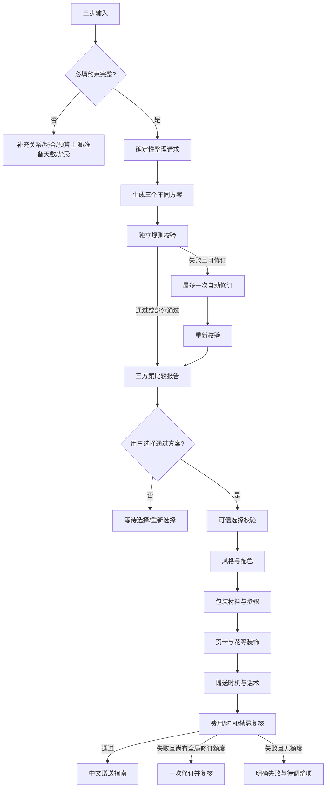

# 产品流程与状态

更新时间：2026-10-30（北京时间）。状态：产品对齐完成，契约决定已记录；缺口 G-1…G-4 待补（见 `docs/pm-reviews/stage-2-acceptance-checklist-2026-10-30.md`）。

## 主流程

## 页面状态

| 状态 | 用户可见内容 | 允许操作 |
|---|---|---|
| `input` | 三步输入、预算／时间确认 | 编辑并提交 |
| `needs_input` | 缺少或无法理解的字段及中文说明 | 补充或修改 |
| `generating` | 正在生成三个方案 | 等待；不可重复提交 |
| `checking` | 正在进行独立规则检查 | 等待 |
| `recommendation_ready` | 三个方案、事实／推断／未知、费用、时间、检查结果 | 选择通过项 |
| `recommendation_partial` | 部分方案通过，失败项及原因 | 仅选择通过项 |
| `repairing` | 正在进行唯一一次自动修订 | 等待 |
| `recommendation_failed` | 无可选方案或修订仍失败 | 修改输入或重新开始 |
| `waiting_selection` | 已有合格方案，尚未选择 | 选择一个；不生成包装 |
| `selection_rejected` | 选择来源、版本或通过状态无效 | 刷新推荐或重新选择 |
| `presenting` | 按顺序生成风格、包装、贺卡／装饰和赠送方式 | 等待 |
| `presentation_failed` | 新增费用、时间、禁忌或结构不合格 | 查看待调整项 |
| `completed` | 可执行赠送指南及未验证事项 | 重新开始 |
| `infrastructure_error` | 模型、Code 或服务暂不可用 | 稍后重试；不视为通过 |

## 关系文案规则

恋人文案可以表达亲密和纪念，但仍不能承诺对方反应。追求对象文案必须保留选择空间，避免公开制造回应压力、默认告白或暗示双方已确定关系。朋友和其他关系使用相应的熟悉程度与场合语气。
